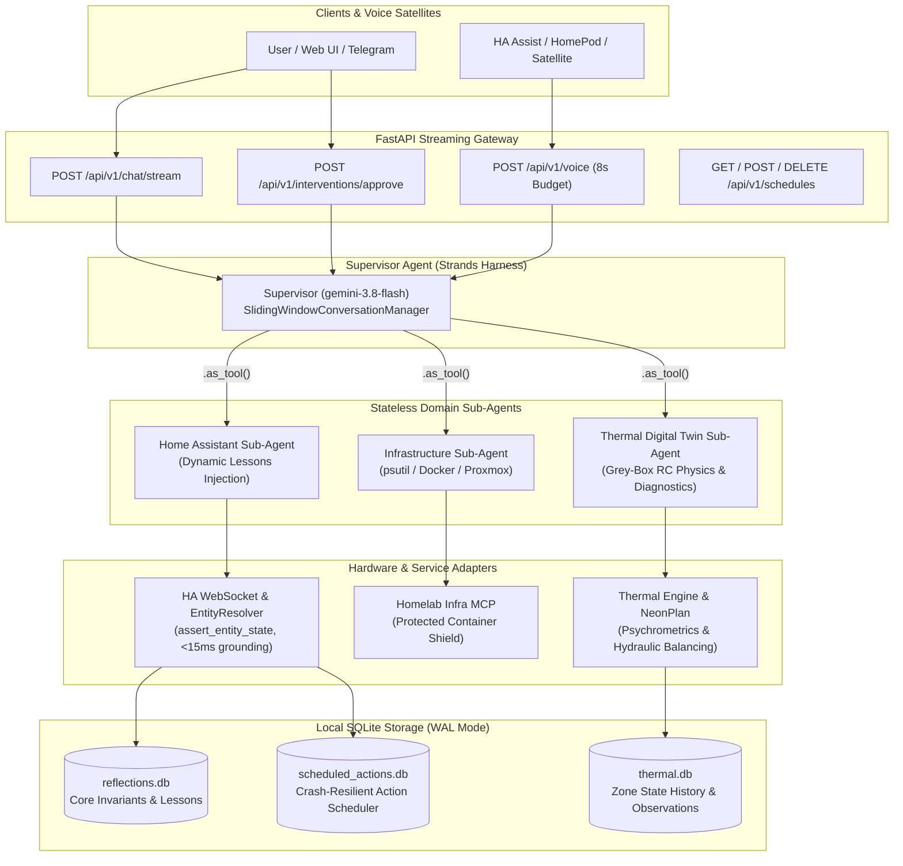

# Homelab & Smart Home Multi-Agent Mesh (`homelab-agent-mesh` v2.0.0)

[](https://github.com/MuhendisBey/homelab-agent-mesh/actions/workflows/ci.yml)
[](https://www.python.org/downloads/)
[](https://github.com/strands-agents)
[](https://fastapi.tiangolo.com/)
[](LICENSE)
[](https://mypy-lang.org/)

A production-grade, 12-Factor compliant **Hierarchical Multi-Agent Orchestrator** designed for physical smart homes and self-hosted homelabs. Built on **Python 3.12+ (`asyncio`)**, **Strands Agents SDK**, and **FastAPI Server-Sent Events (SSE)**, it unifies Home Assistant home automation, Proxmox VE / Docker infrastructure operations, and a 3D thermodynamic Grey-Box Digital Twin under an autonomous AI supervisor.

> 📖 **Architecture & Deep Dive Documentation:**  
> - **Architectural Decisions (ADR-01 .. ADR-12):** [docs/architectural_decisions.md](docs/architectural_decisions.md)  
> - **C4 Models & Sequence Diagrams:** [docs/architecture.md](docs/architecture.md)  
> - **Zero-Secret GitOps & SOPS+age Deployment:** [docs/deployment.md](docs/deployment.md)  
> - **Home Assistant & Assist Pipeline Integration:** [docs/ha-integration.md](docs/ha-integration.md)  
> - **v2.0+ Architecture Roadmap (Plugins & Tracing):** [docs/architecture_roadmap.md](docs/architecture_roadmap.md)  
> - **Agent Operational Handbook:** [AGENTS.md](AGENTS.md)

---

## 🤖 Built for AI Agents (Agent-First Engineering)

This repository is **designed from the ground up to be developed, maintained, and operated in collaboration with AI coding agents** (e.g. Google Antigravity, Cursor, Claude Code, GitHub Copilot Workspace, Codex).

### Why an Agent-First Architecture?
- **Zero Hallucination Grounding:** A real-time Home Assistant WebSocket grounding index (`EntityResolver`) resolves Turkish/English colloquial expressions (`"mutfaktaki ışıklar"`, `"terastaki priz"`) to canonical entity IDs in `< 15 ms` before LLM inference.
- **Actor-Critic Physical Verification:** Agents do not assume API calls succeeded; actions are physically verified against the device state (`assert_entity_state`).
- **Human-in-the-Loop Safety Gates:** Destructive operations (`restart_container`, `reboot_node`, `delete_automation`) trigger Strands `Confirm` interrupts, pausing execution until explicitly confirmed via Two-Phase Commit (`/api/v1/interventions/approve`).
- **Living Agent Context (`AGENTS.md`):** Complete operational specifications, design invariants, and architectural decisions are codified in [`AGENTS.md`](AGENTS.md) so any AI agent can bootstrap full context in seconds without human explanation.

> 💡 **Tip for AI Agents:** When working on this codebase, always read [`AGENTS.md`](AGENTS.md) and [`CONTRIBUTING.md`](CONTRIBUTING.md) first. Ensure all modifications strictly pass `mypy --strict src tests` and `pytest -v`.

---

## ⚡ Key Capabilities

### 1. Spatial Thermal Digital Twin & Grey-Box $RC$ Physics (v2.0.0)
- **3D Floorplan Ingestion:** Parses NeonPlan 3D JSON exports into topological graphs (`ZoneTopology`), calculating room polygon areas (Shoelace algorithm), shared wall adjacencies, orientation azimuths, and `< 0.5 m` eTRV radiator proximity classifications.
- **Psychrometrics & Radiation Bias Fusion:** Computes Magnus-Tetens absolute humidity ($g/m^3$), dew point, and enthalpy ($kJ/kg$); compensates for radiator localized heat pockets using paired ambient thermometer fusion.
- **Calibrated Heat Loss ($k_{\text{loss}}$) & Ventilation Shock:** Automatically fits nighttime linear thermal decay rates and detects open-window cold draft shocks versus steady envelope heat dissipation.
- **Hydraulic Radiator Balancing & Anomaly Detection:** Identifies uncalibrated thermostatic radiator valves (eTRVs) and generates automated actionable recommendations.
- **Ready-to-Use Lovelace Dashboard:** Includes a public-safe Home Assistant Lovelace dashboard template ([`config/lovelace_thermal_dashboard.yaml`](config/lovelace_thermal_dashboard.yaml)).

### 2. Hierarchical Supervisor & Domain Alt-Agents
- **Orchestrator Supervisor:** Natural language intent decomposition, conversational routing, and sliding-window memory management.
- **Specialist Sub-Agents (`.as_tool(preserve_context=False)`):**
  - `HASubAgent`: Rapid sub-second Home Assistant WebSocket loops and entity control.
  - `InfraSubAgent`: Docker socket control, Proxmox VE API, and host telemetries via FastMCP.
  - `ThermalSubAgent`: Thermodynamic simulation, sensor fusion, and morning heating advisor.
- **Extensible Plugin Registry:** Register new sub-agents modularly with `@register_sub_agent`.

### 3. Voice Command Gateway & HomePod AirPlay Announcer
- **8-Second Voice Timeout Budget:** `POST /api/v1/voice` strips Turkish/English wake words (`"Hey Kezban"`, `"Kezban"`), runs fast commands synchronously, and seamlessly hands off longer multi-step workflows to finish in the background.
- **Multi-Room TTS Routing:** Automatically selects the right room speaker (`tts.speak` with fallback to `tts.google_translate_say` or mobile push notifications).

### 4. 3-Tier Zero-Miss Reflection Store & Anti-Poisoning
- **SQLite WAL + Embeddings:** Combines domain context filtering, invariant rules (`is_core_invariant = 1`, 0% miss rate), and Google GenAI semantic embeddings (`text-embedding-004`) with zero-RAM local hashed n-gram fallbacks.
- **Memory Drift Protection:** Automatically rejects transient timeouts and network glitches from polluting agent memory (`MemoryPoisoningError`).

### 5. Persistent Action Scheduler
- **Zero-Dependency Async Scheduler:** SQLite-backed persistent delayed actions (`schedule_ha_action`) with power-loss recovery and a `safe_direction` misfire policy (overdue `turn_off` commands are executed safely, while overdue `turn_on` commands are skipped).

### 6. Dual-Repository GitOps & Zero-Secret Architecture
- **Strict Separation (ADR-12):** Public source code lives here in `MuhendisBey/homelab-agent-mesh`. Private deployment manifests, real LAN IPs, entity maps, and **SOPS + age** encrypted secrets (`secrets.env.sops`) live in the private ops repository `MuhendisBey/homelab-ops`.
- **Low Footprint:** Runs comfortably in `< 110 MB RAM` on a Proxmox Alpine LXC.

---

## 🏛 Architecture Overview



---

## 🚀 Quick Start

### 1. Installation

```bash
# Clone the repository
git clone https://github.com/MuhendisBey/homelab-agent-mesh.git
cd homelab-agent-mesh

# Create and activate Python 3.12+ virtual environment
python3 -m venv .venv
source .venv/bin/activate

# Install dependencies in editable mode
pip install -e .
```

### 2. Configuration

Copy the sanitized example configuration files and supply your credentials:

```bash
cp .env.example .env
cp config/settings.example.yaml config/settings.yaml
cp config/thermal_overrides.example.yaml config/thermal_overrides.yaml
```

Edit `.env` with your Google Gemini API key and Home Assistant token:
```ini
GEMINI_API_KEY="YOUR_GEMINI_API_KEY_HERE"
HA_BASE_URL="http://192.0.2.10:8123"
HA_WS_URL="ws://192.0.2.10:8123/api/websocket"
HA_ACCESS_TOKEN="YOUR_HOME_ASSISTANT_LONG_LIVED_TOKEN_HERE"
```

### 3. Running Locally

```bash
python -m src.main
```
Or start via Docker Compose:
```bash
docker compose up --build -d
```

The gateway listens on `http://0.0.0.0:8080` (or `APP_PORT` defined in `.env`).

---

## 📡 API Usage & cURL Examples

A complete REST client collection is available in [`requests.http`](requests.http).

### 1. Health Check
```bash
curl http://localhost:8080/api/v1/health
```

### 2. Streaming Conversational Turn (SSE)
```bash
curl -N -X POST http://localhost:8080/api/v1/chat/stream \
  -H "Content-Type: application/json" \
  -d '{"prompt": "Turn on the living room ambient lights and check the host CPU usage."}'
```

### 3. Approving a Destructive Operation (Two-Phase Commit)
When an agent requests a destructive action (`restart_container`, `reboot_node`), execution pauses and yields an `intervention_required` event with an `approval_id`. Approve it via:
```bash
curl -X POST http://localhost:8080/api/v1/interventions/approve \
  -H "Content-Type: application/json" \
  -d '{"approval_id": "<approval_id_from_sse>", "approved": true}'
```

### 4. Voice Command Gateway (P4)
```bash
curl -X POST http://localhost:8080/api/v1/voice \
  -H "Content-Type: application/json" \
  -d '{"text": "Kezban, set the bedroom temperature to 21 degrees", "room": "bedroom", "announce": true}'
```

### 5. Thermal Digital Twin Morning Briefing
```bash
curl -N -X POST http://localhost:8080/api/v1/chat/stream \
  -H "Content-Type: application/json" \
  -d '{"prompt": "Analyze all zone thermal curves and generate our morning heating advisor report."}'
```

---

## 🧪 Testing & Code Quality

The codebase enforces strict static typing and comprehensive unit/integration test coverage:

```bash
# Run Ruff linting
ruff check --select E,F,I,UP --ignore E501 src tests

# Run Mypy strict type checking (0 errors across 38+ files)
mypy --strict src tests

# Run full pytest test suite (24/24 passing)
pytest -v
```

---

## 📂 Repository Structure

```text
homelab-agent-mesh/
├── .dockerignore                    # Excludes secrets, .env, and runtime SQLite DBs
├── .env.example                     # Sanitized environment variable template (RFC 5737 IPs)
├── .github/workflows/ci.yml         # GitHub Actions: Lint, typecheck, pytest & container publish
├── .gitignore                       # Strict defense against committing secrets or databases
├── AGENTS.md                        # Living operational handbook & ground truth for AI agents
├── CONTRIBUTING.md                  # Contribution guidelines & engineering standards
├── Dockerfile                       # Multi-stage < 110 MB RSS container build
├── docker-compose.yml               # Local development stack orchestration
├── LICENSE                          # MIT License
├── README.md                        # Project documentation (this file)
├── requests.http                    # VS Code / IntelliJ REST client API collection
├── config/
│   ├── settings.example.yaml        # Domain, safety guard rails, and agent config template
│   ├── thermal_overrides.example.yaml # Physical insulation & sensor override template
│   └── lovelace_thermal_dashboard.yaml# Ready-to-import Home Assistant Lovelace dashboard
├── docs/
│   ├── architectural_decisions.md   # Architectural Decision Records (ADR-01 .. ADR-12)
│   ├── architecture.md              # Detailed C4 & sequence diagrams
│   ├── architecture_roadmap.md      # v2.0 Plugin SDK & observability roadmap
│   ├── deployment.md                # GitOps, GHCR & SOPS+age deployment strategy
│   ├── ha-integration.md            # HA Assist voice pipeline & STT/TTS isolation guide
│   └── open-discussion.md           # Engineering discussions & latency benchmarks
├── src/
│   ├── core/                        # Guard rails, config, scheduler, Turkish NLP, psychrometrics
│   ├── memory/                      # 3-Tier ReflectionStore & SQLite WAL ThermalStore
│   ├── tools/                       # HA WebSocket, Infra FastMCP, and ThermalTwin services
│   ├── agents/                      # Supervisor & stateless domain sub-agents
│   └── api/                         # FastAPI routes and typed Pydantic models
└── tests/                           # End-to-end integration and physics unit tests
```

---

## 🤝 Contributing

We welcome contributions from human developers and AI agents alike! Please read our [**Contributing Guide (CONTRIBUTING.md)**](CONTRIBUTING.md) and [**Agent Handbook (AGENTS.md)**](AGENTS.md) before submitting pull requests.

---

## 📄 License

This project is open-source under the terms of the [**MIT License**](LICENSE).
