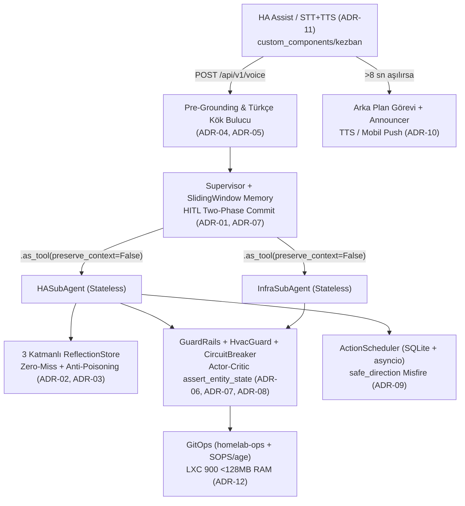

# Mimari ve Tasarım Kararları Kayıt Defteri (ADR Kataloğu)

*Proje: `homelab-agent-mesh` | Kapsam: `v1.0` – `v2.0.1` (+ P5 HA Assist Entegrasyonu)*

Bu doküman; projede bugüne kadar alınan tüm temel mimari ve mühendislik kararlarını (**Architectural Decision Records — ADR**) **"Ne karar verdik? Neden verdik? Kısaca nasıl çalışıyor? Sonuçları ve ödünleşimleri neler?"** sorularını yanıtlayacak biçimde tek bir referans altında toplar.

> [!IMPORTANT]
> **Katı Gizlilik İlkesi:** Bu doküman public depoda yer alır. Gerçek yerel ağ (LAN) IP adresleri, API token'ları, kişisel cihaz kimlikleri veya `homelab-ops/` içerikleri **kesinlikle içermez**. Tüm ağ örnekleri RFC 5737 (`192.0.2.x`) yer tutucularını kullanır.

---

## Özet Karar Tablosu

| ID | Karar Başlığı | Seçilen Yaklaşım | Başlıca Modüller |
| :--- | :--- | :--- | :--- |
| **ADR-01** | Hiyerarşik Orkestrasyon & Alt-Ajan İzolasyonu | `Supervisor` + `.as_tool(preserve_context=False)` + `@register_sub_agent` | [`supervisor.py`](../src/agents/supervisor.py), [`factory.py`](../src/agents/factory.py) |
| **ADR-02** | CoALA Bilişsel Bellek Ayrımı | Working / Episodic-Procedural / Semantic Bellek + Tek Hafif SQLite WAL | [`reflection_store.py`](../src/memory/reflection_store.py), [`entity_resolver.py`](../src/core/entity_resolver.py) |
| **ADR-03** | 3 Katmanlı "Zero-Miss" `ReflectionStore` & Zehirlenme Kalkanı | Domain İzolasyonu + `is_core_invariant` + LRU Embedding + Anti-Poisoning | [`reflection_store.py`](../src/memory/reflection_store.py) |
| **ADR-04** | Olay Tabanlı `EntityResolver` & Sıfır Bağımlılıklı Türkçe Kök Bulucu | WS Event Sync + 4 Aşamalı Çözümleme + `text_tr.py` + Beta-Bernoulli Güveni | [`entity_resolver.py`](../src/core/entity_resolver.py), [`text_tr.py`](../src/core/text_tr.py) |
| **ADR-05** | Birleşik Ön-Çözümleme (`Pre-Grounding`) | LLM öncesi tek `prepare_prompt_context` hattı + canlı durum enjeksiyonu | [`announcer.py`](../src/core/announcer.py), [`routes.py`](../src/api/routes.py) |
| **ADR-06** | Dürüst Actor-Critic Fiziksel Doğrulama | `BaseStateVerifier` (`assert_entity_state`) + `CriticVerdictEvent` | [`interfaces.py`](../src/core/interfaces.py), [`ha_ws_adapter.py`](../src/tools/ha_ws_adapter.py), [`factory.py`](../src/agents/factory.py) |
| **ADR-07** | Savunma Derinliği (Guard Clauses) & İki Aşamalı Onay (`HITL`) | Çift katmanlı `GuardRails` / `HvacSetpointGuard` + Strands `Confirm` & Multi-Interrupt | [`guards.py`](../src/core/guards.py), [`factory.py`](../src/agents/factory.py), [`supervisor.py`](../src/agents/supervisor.py) |
| **ADR-08** | Hibrit Home Assistant Adaptörü & Devre Kesici (`CircuitBreaker`) | Native Async WebSocket + REST + Allowlist'li `ha-mcp` + `CircuitBreaker` | [`ha_ws_adapter.py`](../src/tools/ha_ws_adapter.py), [`ha_agent.py`](../src/agents/ha_agent.py), [`guards.py`](../src/core/guards.py) |
| **ADR-09** | Kalıcı `ActionScheduler` & `safe_direction` Misfire Politikası | Harici Cron olmadan `asyncio` + SQLite (`scheduled_actions`) + Güvenli Yön | [`scheduler.py`](../src/core/scheduler.py), [`schedule_tools.py`](../src/tools/schedule_tools.py) |
| **ADR-10** | Hibrit Ses Geçidi (`8 sn` Senkron Bütçe) & Çok Kanallı `Announcer` | `asyncio.wait` + İptalsiz Arka Plan Devri + TTS + Push Bildirim Yedeği | [`routes.py`](../src/api/routes.py), [`announcer.py`](../src/core/announcer.py) |
| **ADR-11** | Assist Boru Hattında STT/TTS İzolasyonu & İnce Adaptör | `custom_components/kezban` ayrı HA reposunda; STT/TTS tamamen generic | [`ha-integration.md`](ha-integration.md) |
| **ADR-12** | Çift Repolu GitOps, 12-Factor Config & `SOPS + age` Gizlilik Hijyeni | Public kod (`homelab-agent-mesh`) vs Private ops (`homelab-ops`) + `.dockerignore` | [`config.py`](../src/core/config.py), [`deployment.md`](deployment.md) |
| **ADR-13** | Gözlemlenebilirlik Hijyeni, Gizli URL Maskeleme & Healthcheck Filtresi | `SecretRedactingFilter` + `HealthCheckAccessFilter` + `httpx`/`httpx2` `WARNING` | [`logging_utils.py`](../src/core/logging_utils.py), [`main.py`](../src/main.py) |
| **ADR-14** | Konfigürasyon Güdümlü `DomainAssertionPolicy` & Bloklamayan Ses Oturumu | Domain-bazlı ara durum doğrulama + meşgul ses oturumunda `__bg_<hex>` overflow | [`config.py`](../src/core/config.py), [`ha_ws_adapter.py`](../src/tools/ha_ws_adapter.py), [`routes.py`](../src/api/routes.py) |
| **ADR-15** | IANA Zaman Dilimi İzolasyonu, Adaptif Boot Debounce & Rapor Kurtarma | `AppConfig.timezone` (`ZoneInfo`) + 60s boot debounce + `thermal_advisor_reports` | [`thermal_engine.py`](../src/core/thermal_engine.py), [`thermal_store.py`](../src/memory/thermal_store.py), [`thermal_tools.py`](../src/tools/thermal_tools.py), [`entity_resolver.py`](../src/core/entity_resolver.py) |

---

## Kararların Büyük Resimdeki Yeri

---

## ADR-01: Hiyerarşik `Supervisor` Deseni & Durumsuz Alt-Ajanlar (`Agent-as-a-Tool`)

### Ne?
Tek bir dev "monolitik ajan" yerine iki katmanlı hiyerarşik bir yapı seçildi:
- Üstte konuşma bağlamını tutan tek bir **`Supervisor`** ([`supervisor.py`](../src/agents/supervisor.py))
- Altta kendi alan araçlarına sahip, **`preserve_context=False`** ile tamamen durumsuz (stateless) çalıştırılan uzman alt-ajanlar (**`HASubAgent`**, **`InfraSubAgent`**) — Strands SDK'nın `.as_tool()` sarmalayıcısı ([`factory.py#L518-L522`](../src/agents/factory.py#L518-L522)) ve **`@register_sub_agent`** kayıt deseni ([`factory.py#L91-L98`](../src/agents/factory.py#L91-L98)).

### Neden?
- **Araç & Bağlam Kirliliğini Önleme:** HA (`ha-mcp` + WS + zamanlayıcı) ve Infra (`Docker` + `Proxmox` + `psutil`) araçlarının aynı LLM bağlamında birikmesi küçük/hızlı modellerde (Flash sınıfı) yanlış araç seçimine ve token maliyetinin şişmesine yol açar.
- **Open/Closed Genişletilebilirlik:** Yeni bir domain ajanı (örn. medya veya ağ ajanı) eklemek için çekirdek orkestratör kodunu değiştirmek yerine sadece `@register_sub_agent("key")` ile kayıt etmek yeterlidir.
- **HITL Kesinti Aktarımı:** Strands `.as_tool(preserve_context=False)`, alt-ajandaki insan onayı kesintisini (`Confirm`) üst `Supervisor`'a temiz biçimde taşırken her alt-ajan çağrısını izole tutar.

### Kısaca Detay
- `Supervisor`, `SlidingWindowConversationManager` ile kısa dönem oturum geçmişini korur (`window_size: 20`).
- Alt-ajanlar `create_stateless_sub_agent` ile `SequentialToolExecutor` kullanarak adım adım ve doğrulanabilir şekilde çalışır.
- Çalışma anında aktif edilecek alt-ajanlar tamamen YAML yapılandırmasından (`config.agents.sub_agents`) okunur.

### Sonuçları & Ödünleşimler
- **Artıları:** Yüksek araç seçim isabeti, temiz domain izolasyonu, tek ajan bağlam taşmasının engellenmesi, modüler genişleme.
- **Eksileri / Bilinen Ödünleşim:** Fiziksel durum değiştiren basit bir komutta bile (`Supervisor -> HASubAgent -> assert_entity_state -> HASubAgent -> Supervisor`) ek LLM turları oluşarak `> 8 sn` gecikmeye yol açabilmektedir (Bkz. [`open-discussion.md`](open-discussion.md#L11-L52)).

---

## ADR-02: CoALA Bilişsel Bellek Ayrımı & Hafif SQLite WAL Depolama

### Ne?
Bellek tek bir "genel amaçlı sohbet/vektör deposu" olarak değil, **CoALA (Cognitive Architectures for Language Agents)** modeline uygun üç ayrı bilişsel katmana ayrıldı; ağır vektör veritabanları (Qdrant/Chroma vb.) yerine gömülü **SQLite (WAL modu)** seçildi:
1. **Çalışma Belleği (Working Memory):** Oturum bazlı `SlidingWindowConversationManager` + kısa ömürlü `EntityResolver._recent_resolutions` (`TTL = 300s`).
2. **Prosedürel / Epizodik Deneyim Belleği:** [`ReflectionStore`](../src/memory/reflection_store.py) (`lessons_learned` tablosu) — kurallar, cihaz tuhaflıkları ve sabit kısıtlar.
3. **Anlamsal Varlık Belleği (Semantic Entity Grounding):** [`EntityResolver`](../src/core/entity_resolver.py) (`entity_memory` ve `entity_registry_snapshot` tabloları) — doğal dil ifadelerinin gerçek `entity_id` eşlemeleri.

### Neden?
- **RAM Bütçesi (`< 128 MB` / hedef `< 80 MB` RSS):** GMKtec NucBox 3 üzerindeki LXC container kısıtlı bellekle çalışır. Ayrı bir vektör DB veya yerel PyTorch/ONNX embedding modeli çalıştırmak gereksiz bellek tüketimi ve operasyon yükü getirirdi.
- **Karışma Riskini Önleme:** *"Salondaki ışık = `switch.xyz`"* bilgisi ile *"Pencere açıkken kombiyi artırma"* kuralını aynı vektör havuzunda tutmak alakasız bağlamlarda yanlış enjeksiyona neden olurdu.

### Kısaca Detay
- Tüm kalıcı tablolar (`lessons_learned`, `entity_memory`, `entity_registry_snapshot`, `scheduled_actions`) tek bir `reflections.db` dosyasında `PRAGMA journal_mode=WAL`, `PRAGMA busy_timeout=5000` ile tutulur.
- Tüm SQLite okuma/yazma işlemleri `asyncio.to_thread` ile event loop'u bloklamadan yürütülür.

### Sonuçları & Ödünleşimler
- **Artıları:** Sıfır ek container bağımlılığı, `< 80 MB` RSS hedefi içinde kalış, tek dosya yedekleme/taşıma (`just sync-data`).
- **Eksileri:** Milyonluk veri ölçeği için tasarlanmamıştır (homelab ölçeğindeki binlerce satır için lineer kosinüs taraması `< 1 ms` sürmektedir).

---

## ADR-03: 3 Katmanlı "Zero-Miss" `ReflectionStore` & Bellek Zehirlenmesi Kalkanı

### Ne?
Alt-ajanlara kural enjekte eden [`ReflectionStore`](../src/memory/reflection_store.py), klasik "salt RAG/vektör arama" yerine **3 Katmanlı Zero-Miss** bir hat ve **Anti-Poisoning + Tekrar Eşiği** kalkanıyla tasarlandı.

### Neden?
- **Kritik Kural Kaçırma Riski (%0 Kayıp Hedefi):** Salt kosinüs benzerliğine dayalı bir bellekte *"Pencere açıkken 7°C donma korumasını bozma"* kuralı, kullanıcı *"odayı biraz ısıt"* dediğinde semantik eşik (`similarity_threshold`) altında kalıp **unutulabilirdi**.
- **Bellek Zehirlenmesi (Memory Drift):** Geçici bir ağ kesintisinde ajanın *"Cihaz X erişilemez durumda, bir daha deneme"* şeklinde yanlış ders kaydedip kalıcı hafızayı bozması önlenmeliydi.

### Kısaca Detay
1. **Tier 1 (Domain İzolasyonu):** Yalnızca ilgili alan (`domain = 'ha'` veya `'infra'`) sorgulanır; `infra` kuralları `ha` ajanına sızmaz.
2. **Tier 2 (Core Invariants — `is_core_invariant = 1`):** Her çağrıda benzerlik puanına bakılmaksızın `%100` enjekte edilir.
3. **Tier 3 (Semantik Vektör Eşleşmesi — `is_core_invariant = 0`):** Yalnızca `non_core_rows` mevcutsa query embed edilir; `similarity_threshold` (ör. `>= 0.70`) üstündeki kurallar `max_rules_injected` bütçesi içinde enjekte edilir.
- **Embedding & Hız:** [`GeminiEmbedder`](../src/memory/reflection_store.py#L125-L190) (512 girişlik stem-anahtarlı LRU önbelleği ile) kullanır; API erişilemezse sıfır bağımlılıklı [`LocalHashedNgramEmbedder`](../src/memory/reflection_store.py#L82-L122) (BLAKE2b + kelime/3-gram/bigram) devreye girer.
- **Zehirlenme Kalkanı:** `validate_lesson_content()` (`timeout`, `connection refused`, `circuit_open`, `zaman aşımı` vb. kalıpları yakalar) `MemoryPoisoningError` fırlatır; ajan kaynaklı semantik kurallar `occurrence_count >= agent_min_occurrences` (varsayılan `2`) olmadan aktifleşmez (`COS >= 0.88` yakın kopyalarda sayacı artırır).

### Sonuçları & Ödünleşimler
- **Artıları:** Kritik güvenlik kuralları asla atlanmaz; çevrimdışı modda bile hafıza çalışmaya devam eder; geçici hatalar belleği zehirlemez.
- **Eksileri:** `is_core_invariant = 1` sayısı kontrolsüz artırılırsa her prompt'un sistem bağlamını büyütebilir.

---

## ADR-04: Olay Tabanlı `EntityResolver` & Sıfır Bağımlılıklı Türkçe Kök Bulucu

### Ne?
Her kullanıcı komutunda Home Assistant'a `ha_search` / LLM keşfi yaptırmak yerine, **olay tabanlı yerel `EntityResolver`** ([`entity_resolver.py`](../src/core/entity_resolver.py)) + sıfır dış kütüphaneli Türkçe morfoloji motoru ([`text_tr.py`](../src/core/text_tr.py)) inşa edildi.

### Neden?
- **Keşif Maliyeti ve Yanılsama:** 800+ varlıklı bir HA kurulumunda her soruda MCP araması yapmak veya `entity_id` tahmin etmeye çalışmak saniyeler kaybettirir ve yanlış varlık mutasyonlarına yol açar.
- **Türkçe Sondan Eklemeli Yapı & `İ/ı` Sorunu:** Standart Python `.lower()` `"IŞIKLARI"` kelimesini bozarken (`i̇`), *"mutfağındaki"*, *"salondakini"*, *"güneşliğinin"* gibi çok ekli Türkçe tamlamalar basit `substring` aramasında eşleşmiyordu.

### Kısaca Detay
- **4 Katmanlı Tazelik:** Başlangıçta SQLite `entity_registry_snapshot` yüklemesi → canlı HA WebSocket `*_registry_updated` olay aboneliği → kopmada üssel geri çekilme (exponential backoff) ile tam resync → 6 saatte bir tam uzlaştırma (`update.*`, `zone.*`, `sun.*` gürültüsü hariç).
- **4 Aşamalı Çözümleme (`resolve` — `< 15 ms`):**
  - *Stage 0:* Kanonik `entity_id` ve `settings.yaml` statik `entity_aliases` (`0.99`).
  - *Stage 1–2:* CoALA `entity_memory` tam ve bulanık eşleşme (`_beta_bernoulli_confidence`, başarısız belleği cezalandırır).
  - *Stage 3:* Yerel deterministik Grounding Index skorlaması (`light<->switch` uyumu, alan/oda bonusu, `inferred_domains` önceliği).
  - *Stage 4:* Yalnızca `memory_rows` varken ve Stage 0–3 `< 0.85` kaldığında ağ embedding yedeği.
- **Doğrulanmış Öğrenme:** `entity_memory`, tahminden değil **yalnızca** `assert_entity_state` başarıyla tamamlandığında (`verified_action`, 300s TTL pending kuyruğu üzerinden) veya kullanıcı açıkça düzelttiğinde (`record_user_correction`) öğrenir.
- **Türkçe Morfoloji (`text_tr.py`, `v1.3.3`):** `İ/ı` normalizasyonu, `-n-` ve `-s-` kaynaştırma koruması (`salonundaki` → `salon`, `terasın` → `teras`), ünlü düşmesi (`devr→devir`, `vakt→vakit`), ünsüz yumuşaması geri çevirme (`kilid→kilit`, `mutfağ→mutfak`, `güneşliğ→guneslik`), 2 harfli kök koruması (`ev`, `su`, `tv`) ve `"şu"` (`su`) stop-word ayrımı.

### Sonuçları & Ödünleşimler
- **Artıları:** Varlık çözümleme süresi LLM + MCP round-trip (~3–5 sn) yerine **10–15 ms** düzeyine indi; Türkçe çekim eklerinden kaynaklanan yanlış cihaz seçimleri büyük ölçüde ortadan kalktı.
- **Eksileri:** Morfolojik kurallar deterministik ve kural tabanlıdır; tamamen nadir istisna kökler gerektikçe `_VOWEL_PROTECTED_STEMS` / `_HARDENING_MAP` listelerine test güdümlü eklenmelidir.

---

## ADR-05: Birleşik Ön-Çözümleme (`Pre-Grounding` — `prepare_prompt_context`)

### Ne?
Hem metin/SSE (`/api/v1/chat/stream`) hem de ses geçidi (`/api/v1/voice`) için LLM çağrılmadan **önce** çalışan ortak ön-işlemci ([`prepare_prompt_context`](../src/core/announcer.py#L435-L524)) tasarlandı.

### Neden?
- **Salt-Okunur Sorgu Gecikmesi:** *"Mutfak ışıklarının durumu nedir?"* gibi basit bir soru, `Supervisor -> HASubAgent -> resolve_entity -> get_ha_entity_state -> Supervisor` zinciriyle gereksiz yere `> 10–14 sn` sürüyordu.
- **Oda Bağlamı Tutarsızlığı:** Sesli ve yazılı kanallar uyanma kelimesini (`Hey Kezban`), oda bağlamını (`room`) ve varlık enjeksiyonunu aynı kuralla işlemeliydi.

### Kısaca Detay
- Uyanma önekini ayırır (`strip_wake_prefix`), `response_style="voice"` için 1–2 cümlelik Markdown'sız Türkçe yanıt direktifi ekler.
- `EntityResolver` ile eşleşen adayların canlı HA durumunu (`get_state`, `asyncio.gather`, 1.0s timeout) paralel çeker (`learn_pending=False` ile pasif kirliliği önler).
- Prompt'a `[ÖN-ÇÖZÜMLENMİŞ VARLIKLAR (Canlı Home Assistant Verisi)]` bloğunu (`kesin_eşleşme=evet/aday`, `canlı_durum`, parlaklık/sıcaklık öznitelikleri) ekler.
- [`_SUPERVISOR_BASE_PROMPT`](../src/agents/supervisor.py#L85-L90): Salt-okunur sorgularda `kesin_eşleşme=evet` ise alt ajana gitmeden tek turda yanıt verilmesini zorunlu kılar.

### Sonuçları & Ödünleşimler
- **Artıları:** Canlı durum sorguları **~14.8 sn → ~4.15 sn** seviyesine düştü ve kullanıcı bulunduğu odayı söylemeden (`room="mutfak"` + `"Işığı aç"`) cihaz çözümlenebiliyor.
- **Eksileri:** Prompt boyutunu az miktarda artırır; durum değiştiren eylemler güvenlik ve `assert_entity_state` gereği hâlâ alt-ajana gider.

---

## ADR-06: Dürüst Actor-Critic Fiziksel Doğrulama (`BaseStateVerifier`)

### Ne?
Hiçbir servis çağrısı `HA {"success": true}` cevabını "işlem fiziksel olarak gerçekleşti" kabul etmez; [`BaseStateVerifier`](../src/core/interfaces.py#L53-L69) arayüzü üzerinden **`assert_entity_state`** ile gerçek donanım durumu doğrulanır ve sonuç [`CriticVerdictEvent`](../src/agents/factory.py#L367-L379) olarak yayınlanır.

### Neden?
Zigbee/Wi-Fi akıllı anahtarlarda veya medya oynatıcılarda Home Assistant'ın komutu kuyruğa alması, fiziksel rölenin/cihazın durum değiştirdiğini garanti etmez. LLM'in "Açtım" deyip aslında kapalı kalan cihazları halüsinasyonla başarılı raporlaması engellenmeliydi.

### Kısaca Detay
- [`HomeAssistantWSAdapter.assert_state`](../src/tools/ha_ws_adapter.py), önce yapılandırılan hedef duruma/özniteliğe kadar bekler (`default_assert_timeout_sec: 6.0`, `poll_interval_ms: 400`, sayısal `numeric_tolerance: 0.25`) ve yapılandırılmış **`StateAssertionSuccess` / `StateAssertionFailure`** döner.
- [`DomainMemoryAndCriticHooks`](../src/agents/factory.py#L233-L379) alt-ajan oturumu boyunca mutasyon araçlarını (`mutating_tools`) izler; kaç mutasyonun doğrulandığını veya doğrulamasız kaldığını (`unverified_mutations`) SSE'ye `critic_verdict` olayı olarak basar.

### Sonuçları & Ödünleşimler
- **Artıları:** Sıfır halüsinasyonlu fiziksel raporlama, yanlış cihaz eşlemesinin CoALA belleğine yazılmasının önüne geçilmesi.
- **Eksileri:** Donanım tepkisi + doğrulama polingi eylem süresine ~0.5–2 sn ekler; ayrı tool olarak bırakılması da ekstra bir LLM turu doğurur (iyileştirme notu: [`open-discussion.md`](open-discussion.md#L33-L36)).

---

## ADR-07: Savunma Derinliği (Guard Clauses) & İki Aşamalı Onay (`HITL`)

### Ne?
Modelin "sistem promptuna uymasına güvenmek" yerine, saf Python ile deterministik ön-koşul kalkanları ([`guards.py`](../src/core/guards.py)) hem yerel araçların içinde hem de **Strands `InterventionHandler` (`SafetyAndApprovalGate`)** ([`factory.py#L120-L212`](../src/agents/factory.py#L120-L212)) katmanında **iki kez (Defense in Depth)** uygulanır; yıkıcı işlemler insan onayına (`Confirm` / `Two-Phase Commit`) bağlanır.

### Neden?
Harici `ha-mcp` gibi üçüncü parti MCP araçları bizim özel HA adaptörümüzü baypas ederek doğrudan servis çağırabilir; ayrıca prompt injection veya model hatasıyla `35°C` ısıtma ya da kritik bir Docker konteynerini durdurma riski sıfırlanmalıydı.

### Kısaca Detay
- **Çift Katmanlı Guard Clauses:**
  - *`HvacSetpointGuard`:* `min_hvac_temp` (`15.0°C`) – `max_hvac_temp` (`28.0°C`) dışı talepleri (`SafetyBoundViolationError`) ve açık pencere / `8.0°C` donma koruması aktif vanalarda ısıtma artırma taleplerini (`WindowOpenProtectionError`) engeller.
  - *`GuardRails`:* Korumalı Docker konteynerlerini (`protected_containers`) ve Proxmox ID'lerini (`protected_vm_ids`), ardışık döngü limitlerini (`max_loop_iterations`), custom event şablonlarını ve görev başına tool bütçesini (`max_tool_calls_per_task: 12`) denetler.
- **Two-Phase Commit HITL & Multi-Interrupt:** `destructive_tools_requiring_approval` listesindeki bir işlem (`restart_container`, `reboot_node` vb.) çağrıldığında `Confirm` döner; akış askıya alınır, `approval_id` yayınlanır ve `/api/v1/interventions/approve` ile devam eder. Tek promptta birden çok yıkıcı işlem istendiğinde `resolved_interrupt_responses` tamponu sırayla/topluca çözümlemeyi destekler.

### Sonuçları & Ödünleşimler
- **Artıları:** Model ne üretirse üretsin fiziksel/altyapı sınırları deterministik biçimde korunur; çok adımlı yıkıcı işler yarım kalmaz.
- **Eksileri:** Onay bekleyen sesli komutlarda etkileşimli onay akışı gerekir (`status="approval_required"`).

---

## ADR-08: Hibrit Home Assistant Katmanı (Native WS + REST + Allowlist `ha-mcp`) & `CircuitBreaker`

### Ne?
Tek bir protokole bağımlı kalmak yerine üçlü hibrit bir erişim mimarisi + [`CircuitBreaker`](../src/core/guards.py#L59-L120) koruma kalkanı seçildi:
1. **Native Async WebSocket:** Alt-saniyelik döngüler (`execute_sequential_loop`), özel olay fırlatma ve HA Registry senkronizasyonu için.
2. **REST Fallback:** Durum sorguları (`/api/states/...`) ve servis çağrıları için.
3. **Harici `ha-mcp` (Allowlist'li):** Geniş keşif/yardımcı araçlar (`ha_search`, `ha_get_overview`, `ha_get_history` vb.) için; `tool_allowlist` ile kısıtlı ve `continue_on_error=True` ile dayanıklı.

### Neden?
Standart MCP tek başına milisaniyelik ardışık WebSocket döngülerini verimli yapamaz ve gerçek zamanlı `*_registry_updated` olaylarını itmez. Öte yandan salt el yazması adaptörle HA'nın tüm nadiren kullanılan keşif/takvim/şablon özelliklerini yeniden yazmak gereksiz mühendislik yüküydü.

### Kısaca Detay
- Her adaptör arka planda bağımsız bir `CircuitBreaker` (`CLOSED -> OPEN -> HALF_OPEN`, `failure_threshold: 3`, `reset_timeout_sec: 30.0`) kullanır.
- `GuardViolationError` ve `404 ResourceNotFoundError` hataları "backend çökmesi" değil "çağıran hatası" sayılarak devreyi açmaz ([`guards.py#L62-L63`](../src/core/guards.py#L62-L63)); `CircuitOpenError` durumunda sonsuz yeniden deneme fırtınaları engellenir.

### Sonuçları & Ödünleşimler
- **Artıları:** Hem düşük gecikmeli WS kontrolü hem zengin `ha-mcp` keşif yeteneği bir aradadır; çöken bir backend sistemi kilitlemez.
- **Eksileri:** `ha-mcp` bağlantısı alt-ajan inşasında araç listesine eklenir; uzun keşiflerde araç sayısı bağlama etki eder.

---

## ADR-09: Kalıcı `ActionScheduler` (`SQLite + asyncio`) & `safe_direction` Misfire Politikası

### Ne?
*"Klimayı 10 dakika çalıştır sonra kapat"* gibi ertelenmiş komutlar için APScheduler veya harici cron yerine sıfır ek bağımlılıklı **`asyncio` + SQLite (`scheduled_actions`)** tabanlı [`ActionScheduler`](../src/core/scheduler.py) geliştirildi.

### Neden?
- Hafıza/container limitleri altında ek zamanlayıcı kütüphanesi veya ayrı Redis/Celery kuyruğu istemiyorduk.
- `asyncio.sleep` ile beklemek hem konuşma oturumunu kilitliyor hem container yeniden başladığında zamanlanmış görevin tamamen kaybolmasına neden oluyordu.
- Elektrik/servis kesintisi sonrası gecikmiş bir işin rastgele çalışması tehlikeli olabilirdi (ör. saatler sonra gecikmiş "fırını/ısıtıcıyı aç" komutu çalışmamalı, ama "kapat" komutu mutlaka çalışmalıydı).

### Kısaca Detay
- `asyncio.Event` uyandırmalı döngü ile sıfır boşa CPU tüketimi (`polling` yok), tek seferde çalışan `_exec_lock` muteksi.
- **Kaza Kurtarma:** Başlangıçta yarım kalmış `running` işleri güvenli şekilde yeniden kuyruğa alır.
- **`safe_direction` Misfire Politikası:** `misfire_grace_sec` (varsayılan `300s`) aşılmışsa yalnızca `is_safe_closing_action` (`turn_off`, `close_cover`, `lock`, `climate/hvac_mode=off`) işlerini yürütür, açma/ısıtma komutlarını atlar.
- Çalışma anında guard'ları yeniden denetler, servisi çalıştırır, `assert_state` yapar ve geçici hatada 1 kez otomatik yeniden dener (`max_attempts: 2`).

### Sonuçları & Ödünleşimler
- **Artıları:** Yeniden başlatmalara dayanıklı, güvenlik odaklı zamanlama; tamamlanan işleri `ScheduleResultEvent` ile sesli bildirebilme.
- **Eksileri:** Tek node içi zamanlayıcıdır (yüksek erişilebilirlikli çoklu replika kümesi için tasarlanmamıştır).

---

## ADR-10: Hibrit Ses Geçidi (`8 sn` Bütçe) & Çok Kanallı `Announcer`

### Ne?
Home Assistant Assist ve Apple Watch / iPhone gibi istemcilerin HTTP zaman aşımına düşmemesi için [`POST /api/v1/voice`](../src/api/routes.py#L577-L670) uç noktası **8 saniyelik (`sync_timeout_sec: 8.0`) senkron bütçe + iptalsiz arka plan devri** ve çok kanallı [`Announcer`](../src/core/announcer.py) ile tasarlandı.

### Neden?
- Mobil / ses istemcileri 15–20 saniye yanıt beklerse HTTP bağlantısını kesip hata verir.
- Öte yandan zaman aşımında ajanı `cancel()` etmek başlatılmış fiziksel işlemleri yarıda bırakırdı.
- HomePod gibi yerel hoparlörler henüz bağlı olmadığında veya `tts.speak` başarısız olduğunda, arka planda tamamlanan işin sonucu kullanıcıya sessizce kaybolmamalıydı.

### Kısaca Detay
- `voice_command` içinde ajan arka plan `Task` olarak başlatılır; `asyncio.wait(timeout=sync_timeout_sec)` ile beklenir. Süre içinde biterse yanıt anında sesli/yazılı metin olarak döner (`timed_out=False`).
- Süre dolarsa görev **iptal edilmeden** `_announce_when_done` izleyicisine bağlanır ve istemciye anında `status="accepted_background"` ile onay cümlesi (`deferred_ack_text`) döndürülür.
- `Announcer`: Hedef hoparlörü `speaker_entity -> room_speakers -> EntityResolver(media_player) -> default_speaker` sırasıyla arar (`tts.speak`, hata verirse `tts.google_translate_say` yedeği); hoparlör yoksa veya TTS başarısız olursa `voice.fallback_notify_service` (ör. `notify.mobile_app_*`, WS `target` alanı olmadan) ile anlık push bildirim gönderir.

### Sonuçları & Ödünleşimler
- **Artıları:** İstemci asla kilitlenmez veya timeout almaz; sonuç HomePod yoksa bile iPhone bildirimiyle kesin ulaşır.
- **Eksileri:** 8 saniye eşiğinin biraz üzerindeki komutlarda kullanıcı ilk aşamada *"Üzerinde çalışıyorum..."* duyar, ardından gerçek sonucu bildirimle alır (`open-discussion.md` içinde hızlandırma seçenekleri açık).

---

## ADR-11: Assist Boru Hattında STT/TTS İzolasyonu & Ayrı HA Reposu

### Ne?
Ses tanıma (STT) ve ses sentezleme (TTS) motorları `homelab-agent-mesh`'in tamamen dışında (generic HA bileşeni olarak) bırakıldı; HA ile konuşan entegrasyon da ayrı **`homeAssistant`** reposunda **ince adaptör (`custom_components/kezban`)** olarak geliştirildi (Ayrıntılar: [`ha-integration.md`](ha-integration.md)).

### Neden?
- `homelab-agent-mesh`'in ses akışı (audio stream / codec / Whisper) işlemesi konteyner RAM bütçesini aşar ve gereksiz bağımlılık yaratırdı.
- Home Assistant `custom_components` kodunu bu Orkestratör reposuna karıştırmamak, iki yaşam döngüsünü (HA Core eklentisi vs AI Mesh) temiz tutar.

### Kısaca Detay
- `homelab-agent-mesh` içeriye yalnızca UTF-8 metin alır (`text`, `conversation_id -> session_id`, `room`) ve geriye temizlenmiş UTF-8 `speech` döndürür.
- `custom_components/kezban` yalnızca `AbstractConversationAgent` arayüzünü uygulayıp `POST /api/v1/voice` çağrısı yapar; içinde prompt, bellek veya varlık mantığı tutmaz.

### Sonuçları & Ödünleşimler
- **Artıları:** Yarın STT/TTS motoru (Google Cloud, Whisper, Apple yerel dikte vb.) değiştirildiğinde ajan kodunda tek satır değişmez; bağımlılık yalnızca HTTP JSON sözleşmesidir.
- **Eksileri:** HA Voice Pipeline tarafında ve LXC tarafında iki ayrı bileşen dağıtımı gerektirir.

---

## ADR-12: Çift Repolu GitOps, 12-Factor Yapılandırma & `SOPS + age`

### Ne?
Kaynak kodu ve dağıtım/sırlar katmanı iki ayrı depoya bölündü: **public** `MuhendisBey/homelab-agent-mesh` vs **private** `MuhendisBey/homelab-ops`; tüm yapılandırma `pydantic-settings` + **`SOPS + age`** ile yönetildi (Ayrıntılar: [`deployment.md`](deployment.md)).

### Neden?
- Ev topolojisi, iç ağ IP'leri, cihaz adları, API anahtarları ve SSH ayarları açık kaynaklı uygulama deposuna asla sızmamalıydı.
- Apple Silicon (`arm64`) geliştirme makinesinden `x86_64` (`linux/amd64`) Proxmox LXC hedefine tutarlı, yerel QEMU derlemesi gerektirmeyen, tek komutla geri döndürülebilir (`just rollback <tag>`) bir yayın hattı gerekiyordu.

### Kısaca Detay
- [`config.py`](../src/core/config.py): Öncelik sırası `Ortam Değişkenleri > .env > config/settings.yaml`. `_StrictModel` (`extra="forbid"`) ile YAML yazım hataları açılışta yakalanır; sıfır ortam-özel varsayılan değer içerir.
- `mesh-release` dalı yalnızca takip edilen kaynak kodu GitHub `main`'e ve private GHCR'ye taşır; GitHub Actions (`ci.yml`) `ruff`, `mypy --strict`, `pytest`, secret hygiene denetimi ve `linux/amd64` container build'ini otomatik koşar.
- `homelab-ops` tarafında `secrets.env.sops`, `age` anahtarıyla şifreli saklanır; `just deploy` sırasında çözülüp doğrudan SSH pipe üzerinden hedef LXC'ye `0600` izinle yazılır.

### Sonuçları & Ödünleşimler
- **Artıları:** Sıfır sır sızıntısı, tekrarlanabilir `linux/amd64` imajları, saniyeler içinde versiyon bazlı geri dönüş (`just rollback`).
- **Eksileri:** Yayın sırasında çift dal (`main` + `mesh-release`) senkronizasyonuna dikkat edilmelidir (otomatik olmayan adımlarda `git add -A` asla kullanılmamalı, yalnızca izlenen dosyalar aşamalandırılmalıdır).

---

## ADR-13: Gözlemlenebilirlik Hijyeni, Gizli URL Maskeleme & Sağlık Kontrolü Filtrelemesi

### Ne?
Uygulama günlüğü yapılandırması tek sorumluluklu [`logging_utils.py`](../src/core/logging_utils.py) modülüne ayrıldı ve üçlü log hijyeni katmanı eklendi:
1. `SecretRedactingFilter` (`/private_***`, `Bearer ***` ve gizli sorgu parametreleri için).
2. `HealthCheckAccessFilter` (başarılı `200 OK` `/api/v1/health` erişim loglarını bastırma).
3. `httpx`, `httpx2` ve `httpcore` istemci günlüklerinin `WARNING` seviyesine yükseltilmesi.

### Neden?
- Canlı konteyner denetiminde `httpx2` `INFO` kayıtlarının harici MCP gizli uç nokta yolunu (`/private_***`) açık metin olarak `stdout` loglarına yazdığı görüldü.
- 30 saniyelik Docker healthcheck istekleri ile 15 dakikalık rutin `httpx` yoklamaları konteyner loglarının büyük bölümünü kaplayarak gerçek hata ve davranış analizini zorlaştırıyordu.

### Kısaca Detay
- [`configure_logging`](../src/core/logging_utils.py#L60-L88), root logger, root handler'lar, Uvicorn logger'ları (`uvicorn`, `uvicorn.error`, `uvicorn.access`) ve HTTP istemcilerine filtreleri idempotent olarak (`_attach_filter_once`) ekler.
- `SecretRedactingFilter`, `record.getMessage()` çıktısını ve `exc_text` alanını maskeler; `HealthCheckAccessFilter` ise yalnızca `/api/v1/health` + ` 200` birleşimini süzer, `4xx`/`5xx` sağlık hatalarını görünür bırakır.

### Sonuçları & Ödünleşimler
- **Artıları:** Log sızıntısı riski ortadan kalkar, konteyner logları okunabilir hale gelir, tek bir `logging_utils` modülü üzerinden merkezi yönetim sağlanır (SRP).
- **Eksileri:** İstek düzeyinde ham HTTP debug logu gerektiğinde geçici olarak `LOG_LEVEL=DEBUG` veya logger seviyesini değiştirme gerekir (ancak `SecretRedactingFilter` o durumda da aktif kalır).

---

## ADR-14: Konfigürasyon Güdümlü `DomainAssertionPolicy` & Bloklamayan Ses Oturumu

### Ne?
Fiziksel olarak yavaş hareket eden aktüatörler (`cover.*`) için sabit doğrulama penceresi yerine `settings.yaml` tabanlı **`DomainAssertionPolicy`** ([`config.py`](../src/core/config.py#L171-L176)) tanımlandı ve `/api/v1/voice` uç noktasında arka plan görevi kilidi varken gelen eşzamanlı sesli komutların `409 Conflict` ile reddedilmesi yerine izole taşma oturumuna (**overflow session**) yönlendirilmesi benimsendi.

### Neden?
- Motorlu güneşlik ve perdeler fiziksel olarak 15–25 saniyede kapanır. Varsayılan `6.0 sn` / `400 ms` `assert_state` döngüsü cihaz henüz `closing` durumundayken `StateAssertionFailure` üretiyor, LLM ise komutu başarısız sanıp gereksiz tekrarlar yaparak komutu `30–50 sn` uzatıyordu.
- Bir sesli komut 8 sn bütçesini aşıp arka plana devredildiğinde `session.lock` tutulmaya devam ediyordu; aynı oturum kimliğiyle peş peşe gelen yeni sesli komutlar kullanıcıya soğuk `409 Conflict` hatası döndürüyordu.

### Kısaca Detay
- `home_assistant.domain_assert_policies` altında domain bazlı `timeout_sec`, `poll_interval_ms` ve `transitional_states` (ör. `cover` için `closed -> ["closing"]`, `open -> ["opening"]`) yapılandırılır.
- [`HomeAssistantWSAdapter._matches`](../src/tools/ha_ws_adapter.py#L384-L420), ara durum eşleşmesini yalnızca devlet (state) düzeyinde kabul eder; açıkça `expected_attributes` (ör. `current_position=0`) istenmişse ara durum öznitelik doğrulamasını **asla baypas etmez** ve `StateAssertionSuccess.actual_state` donanımın gerçek durumunu (`"closing"`) dürüstçe raporlar.
- [`_acquire_voice_session`](../src/api/routes.py#L123-L147): Oturumda bekleyen HITL onayı (`pending_approvals`) varsa güvenliği korumak adına `409 Conflict` vermeyi sürdürür; yalnızca `session.lock.locked()` durumunda yeni komutu `<session_id>__bg_<hex>` izole oturumuna yönlendirir.

### Sonuçları & Ödünleşimler
- **Artıları:** Yavaş cihazlarda sahte timeout/retry döngüsü ve gereksiz REST yoklaması biter; eşzamanlı sesli komutlar bloklanmaz; yeni aktüatör tipleri kod değiştirmeden YAML'dan eklenir (Open/Closed).
- **Eksileri:** Taşma oturumu (`__bg_<hex>`), ana oturum meşgulken çalıştığı için ana oturumun o anki konuşma penceresinden bağımsızdır (oturum TTL/LRU ile otomatik temizlenir).

---

## ADR-15: IANA Zaman Dilimi İzolasyonu, Adaptif Boot Debounce & Restart-Dayanıklı Rapor Kurtarma

### Ne?
1. Konteyner OS saat diliminden bağımsız IANA zaman dilimi yönetimi (`AppConfig.timezone` + `ZoneInfo`), `daily_briefing_time` (`20:00`, `morning_briefing_time` geriye uyumlu) ve yerel saatte gece penceresi hesabı.
2. `EntityResolver` açılışta çift senkronizasyonun kaldırılması ve HA yeniden başlatmalarındaki `registry_updated` fırtınası için 60 saniyelik adaptif `boot_debounce_sec=10.0` (404 self-healing `0.2s` korunarak).
3. Termal danışman raporunun `thermal_advisor_reports` tablosunda kalıcı saklanması ve HA yeniden başlatması sonrası eksikse otomatik yeniden yayınlanması (`_republish_advisor_if_missing`).

### Neden?
- Konteyner UTC'de çalışırken `07:30` brifingi kışın `08:30`, yazın `09:30` yerel saatte tetikleniyordu ve gece soğuma penceresi UTC saatine kayıyordu.
- HA restart olduğunda entegrasyonlar art arda yüklenirken `1.5s` debounce nedeniyle 35 saniyede 5–6 kez tam Grounding Index + SQLite snapshot yazımı tetikleniyordu.
- HA yeniden başladığında yalnızca bellekte tutulan sanal `advisor_report` sensörü bir sonraki günlük brifinge kadar HA'dan kayboluyordu; ayrıca ajan konteyneri restart olduğunda aynı gün tekrar brifing tetiklenme riski vardı.

### Kısaca Detay
- [`ThermalPhysicsEngine`](../src/core/thermal_engine.py#L446-L457) ve [`ThermalTwinService._maybe_run_daily_briefing`](../src/tools/thermal_tools.py#L583-L601) zaman kontrollerini `config.tzinfo` (`ZoneInfo`) üzerinden yapar.
- [`ThermalStore`](../src/memory/thermal_store.py#L361-L435) son raporu `thermal_advisor_reports` tablosuna yazar; `ThermalTwinService.initialize()` son günlük brifing tarihini geri yükler ve `run_live_tick(publish=True)` HA'da sensör eksik/bilinmeyen durumdaysa orijinal zaman damgasını koruyarak otomatik yeniden yayınlar.
- [`EntityResolver`](../src/core/entity_resolver.py#L331-L445), `enable_ws_listener=True` iken gereksiz `er_initial_sync` görevini açmaz ve WS bağlandıktan sonraki `ws_boot_settle_sec` (60 sn) penceresinde olayları `boot_debounce_sec` (10 sn) altında birleştirir.

### Sonuçları & Ödünleşimler
- **Artıları:** Zaman dilimi kayması ve çift brifing sıfırlanır; HA restart sonrası hem danışman panosu hem varlık indeksi ekstra müdahale olmadan toparlanır.
- **Eksileri:** HA açılışı sırasındaki yeni cihaz kayıtlarının Grounding Index'e yansıması ilk 60 sn içinde en fazla 10 sn gecikmeli (tek toplu senkronizasyonla) gerçekleşir.

---

## İlişkili Dokümanlar
- [Mimari Spesifikasyon (`v1.1` C4 & Sekans Diyagramları)](architecture.md)
- [Gelecek Yol Haritası (`v2.0` Plugin SDK & Tracing)](architecture_roadmap.md)
- [Dağıtım & Çift Repolu GitOps Rehberi](deployment.md)
- [Home Assistant & Assist Entegrasyon Mimarisi](ha-integration.md)
- [Açık Tartışma & Performans Notları](open-discussion.md)
