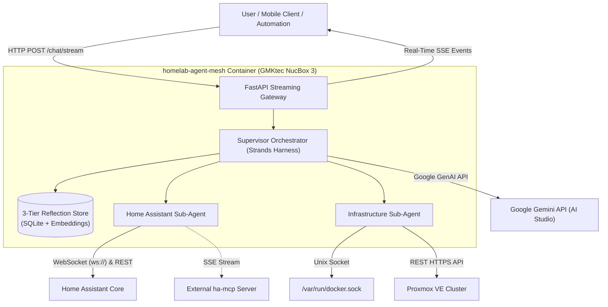
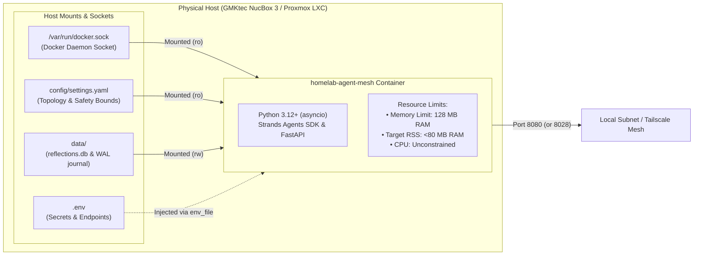
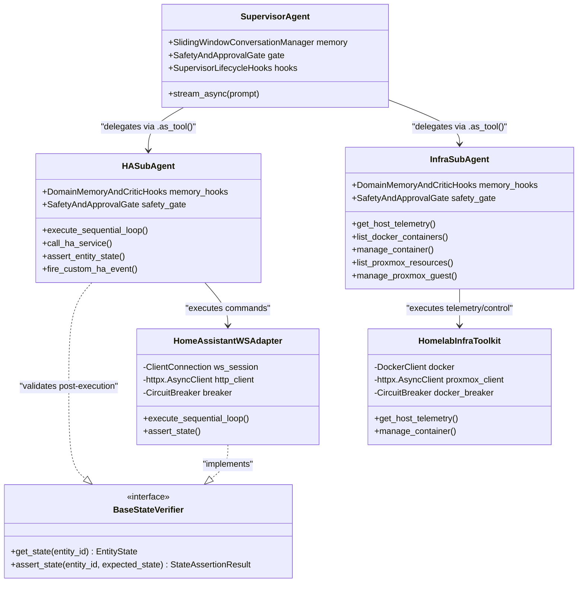
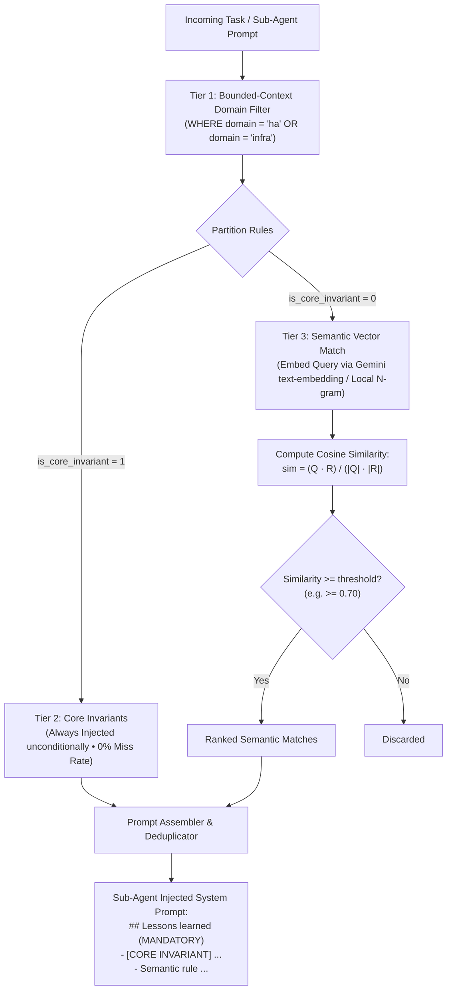
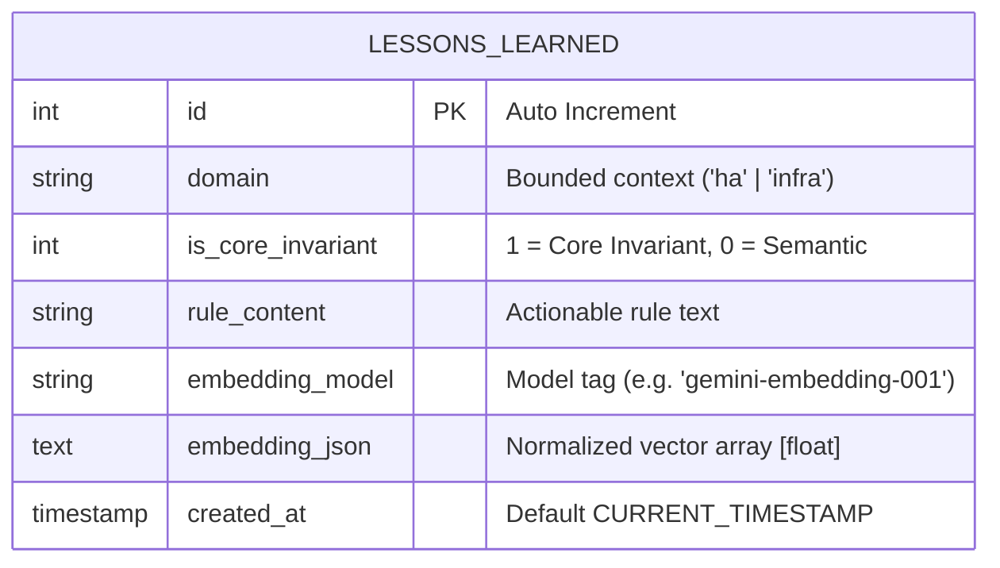
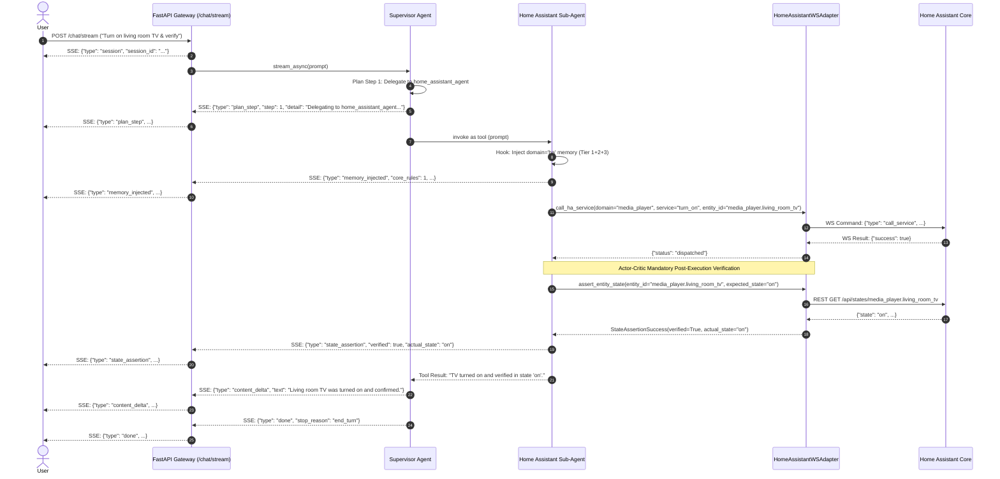
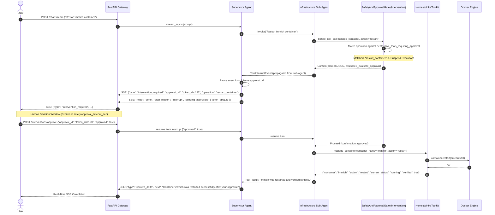
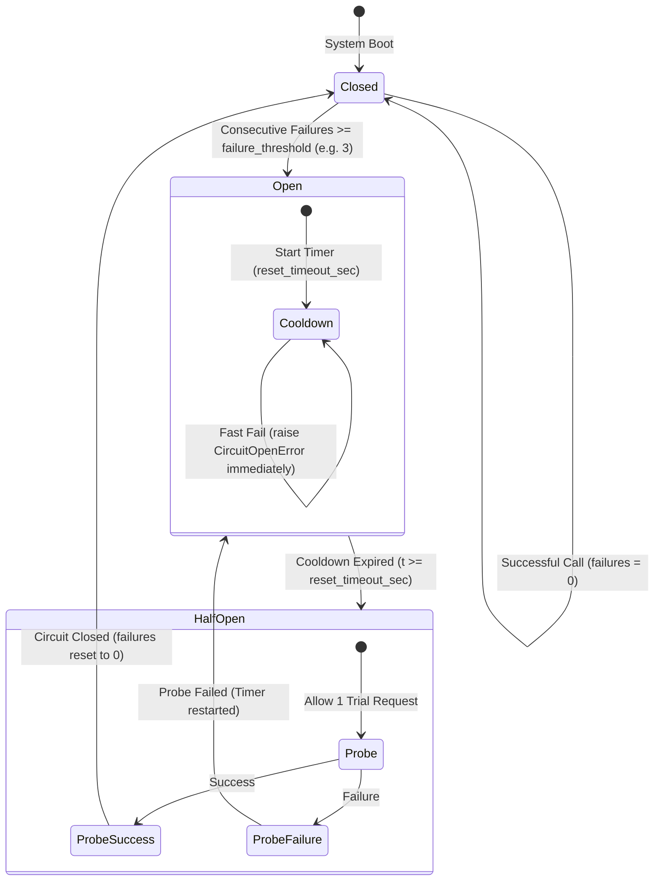
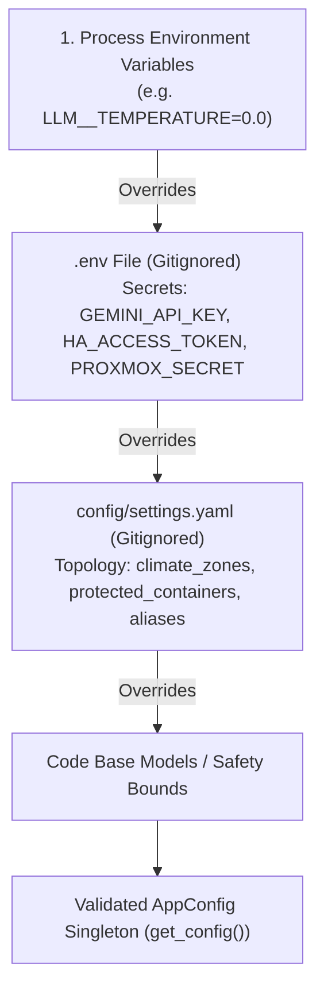

# Architecture Specification & Engineering Guide (v1.0)
*Homelab & Smart Home Multi-Agent Mesh (`homelab-agent-mesh`)*

---

## 1. System Overview & Context (C4 Level 1)

`homelab-agent-mesh` is a production-grade, hierarchical multi-agent orchestrator designed to safely and deterministically control a private smart home and homelab cluster. It integrates large language models (**Strands Agents SDK + Google Gemini**), physical home automation (**Home Assistant via Native WebSocket + REST + MCP**), and system infrastructure (**Docker Engine + Host Telemetry + Proxmox VE**).



---

## 2. Deployment Architecture (C4 Level 2)

The mesh runs inside an isolated Docker container on a **GMKtec NucBox 3** (or Proxmox LXC container) with strict resource reservations and read-only volume mounts adhering to the **12-Factor App** methodology.



---

## 3. Component Architecture & Task Decomposition (C4 Level 3)

The architecture strictly follows the **Supervisor / Agent-as-a-Tool** pattern. Specialist sub-agents are exposed to the root orchestrator via Strands' native `.as_tool(preserve_context=False)` adapter, enforcing stateless, isolated turns while propagating human intervention interruptions to the parent.



---

## 4. 3-Tier Zero-Miss Reflection Store Architecture

To eliminate LLM amnesia and prevent repeat failures (such as fighting frost protection automations or hitting dead endpoints), reflections are persisted into an ACID-compliant SQLite store with a **3-Tier retrieval pipeline**:



### Entity-Relationship Diagram



---

## 5. End-to-End Sequence Diagrams

### 5.1. Multi-Intent Decomposition & Actor-Critic Execution



---

### 5.2. Two-Phase Commit: Human-in-the-Loop Intervention Flow

Destructive operations (defined in `safety.destructive_tools_requiring_approval`) cannot proceed autonomously. Execution is suspended in-flight, an authorization token is issued, and execution resumes only upon explicit approval.



---

### 5.3. Pre-Condition Guard Clause Short-Circuit (Window Open Protection)

```mermaid
sequenceDiagram
    autonumber
    actor User
    participant Gateway as FastAPI Gateway
    participant Supervisor as Supervisor Agent
    participant HASub as Home Assistant Sub-Agent
    participant Guard as HvacSetpointGuard
    participant Adapter as HomeAssistantWSAdapter

    User->>Gateway: POST /chat/stream ("Set living room heating to 22.5C")
    Gateway->>Supervisor: stream_async(prompt)
    Supervisor->>HASub: invoke("Set living room heating to 22.5C")
    
    HASub->>Guard: validate_intent(climate.main_thermostat, temp=22.5)
    Guard->>Adapter: get_state("binary_sensor.living_room_window_contact")
    Adapter-->>Guard: EntityState(state="on") [WINDOW OPEN]
    
    Note over Guard: Window is OPEN: override would waste energy & break Memento!
    Guard-->>HASub: raise WindowOpenProtectionError("Window sensor is open; heating changes blocked.")
    
    HASub-->>Supervisor: Tool Result Error: "WindowOpenProtectionError"
    Supervisor-->>Gateway: SSE: {"type": "content_delta", "text": "Cannot adjust heating: Living room window is currently open (frost protection active)."}
    Gateway-->>User: Final safe response (No physical command was dispatched)
```

---

## 6. Circuit Breaker & Resilience State Machine

To prevent infinite retry loops or network storms when Home Assistant, Docker, or Proxmox VE become temporarily unreachable, all external adapters run behind a `CircuitBreaker`.



---

## 7. Configuration Sourcing & Precedence (12-Factor App)

Configuration loading is strictly ordered by precedence using `pydantic-settings`:



---

## 8. Summary of Non-Negotiable Architectural Guarantees

| Guarantee | Mechanism | Verification Method |
| :--- | :--- | :--- |
| **Zero Secret Leakage** | `pydantic-settings` `SecretStr` + strict `.gitignore` | Automated diff scan + pre-push audit |
| **No Unauthorized Destructive Ops** | Strands `InterventionHandler` Two-Phase Commit | Automated test `test_sse_chat_and_two_phase_commit_intervention` |
| **Zero-Miss Critical Rules** | SQLite Reflection Store with `is_core_invariant = 1` | Automated test `test_reflection_store_three_tier_retrieval` |
| **No Hallucinated Actions** | Post-execution `assert_entity_state` polling/subscription | `StateAssertionSuccess` / `StateAssertionFailure` audit |
| **Runaway Action Prevention** | Loop bounds (`max_loop_iterations`, `min_loop_delay_ms`) | Pre-condition checks in `GuardRails` |
| **Low Resource Footprint** | Multi-stage Docker build, zero heavy vector DB, local embed fallback | Running RSS benchmark (<80 MB RAM) |
