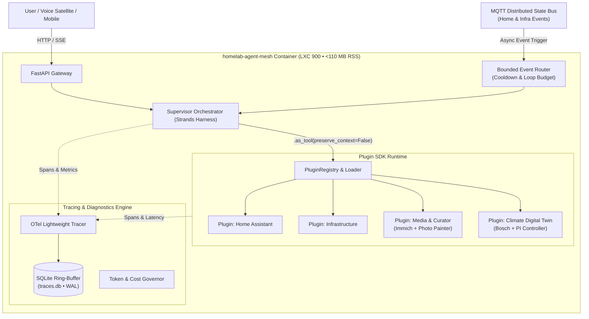
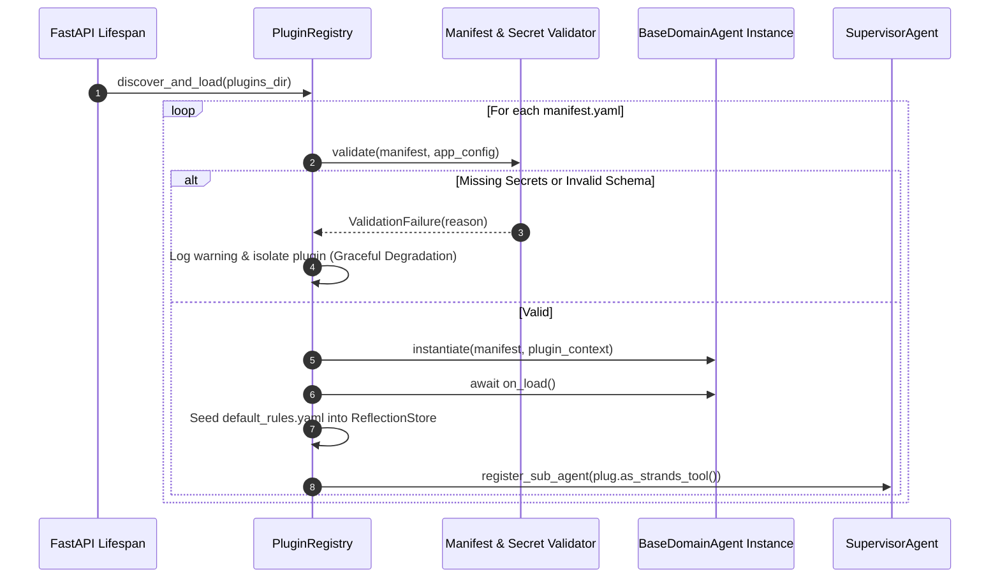

# Architecture Specification & Future Roadmap (v2.0)
*Extensible Plugin SDK, Distributed Tracing & Performance Diagnostics (`homelab-agent-mesh`)*

---

## 1. Executive Summary & v2.0 Vision

Building upon the deterministic **v1.0** foundation (Supervisor/Sub-Agent mesh, 3-Tier Reflection Store, Actor-Critic verification, and Two-Phase Commit interventions) and **v1.1** grounding/scheduling extensions (`EntityResolver`, `Scheduler`), **v2.0** evolves `homelab-agent-mesh` into an **extensible, self-observing HomeOS kernel**—without introducing the maintenance overhead of a custom Linux distribution.

### Core Objectives
1. **Open/Closed Extensibility (Plugin SDK):** Enable third-party and domain-specific specialist agents (e.g., *Media Curator*, *Climate Digital Twin*, *Home SRE*) to be added as self-contained, plug-and-play modules without modifying core orchestrator code.
2. **End-to-End Observability (Tracing & Diagnostics):** Provide microsecond-level execution tracing, latency bottleneck attribution (LLM vs. Network vs. Hardware), token/cost accounting, and host resource correlation (GMKtec NucBox 3 / LXC 900) within a strict `< 110 MB` RSS memory budget.
3. **Bounded Event-Driven Autonomy:** Allow plugins to subscribe to asynchronous infrastructure/home events (via MQTT Distributed State Bus) protected by deterministic rate limits and loop budgets.

---

## 2. System Context & v2.0 Architecture (C4 Level 2/3)



---

## 3. Pillar 1: Modular Plugin SDK Architecture (SOLID / OCP)

To satisfy the **Open/Closed Principle (OCP)** and **Dependency Inversion Principle (DIP)**, specialist agents are decoupled from `src/agents/` core wiring and loaded dynamically through a standardized **Plugin SDK**.

### 3.1. Plugin Directory Structure
Plugins can be loaded either from a local volume mount (`/opt/stacks/agent-mesh/plugins/`) or installed as standard Python packages exposing the `homelab_mesh.plugins` entry point:

```text
plugins/
└── media_curator/
    ├── manifest.yaml          # Declarative metadata, capabilities & requirements
    ├── plugin.py              # Implements BaseDomainAgent
    ├── tools.py               # Domain-specific tools & adapters
    └── default_rules.yaml     # Seed core invariants for ReflectionStore
```

### 3.2. Declarative Plugin Manifest (`manifest.yaml`)
Every plugin declares its contract, required secrets, and safety boundaries upfront. If a required secret is missing in `.env`, the `PluginRegistry` gracefully skips the plugin with a structured warning instead of crashing the mesh.

```yaml
api_version: "mesh.v2"
name: "media_curator"
version: "1.0.0"
display_name: "Media & E-Ink Display Curator"
description: >
  Searches Immich photo libraries by semantic/date criteria, optimizes image
  contrast/dithering, and publishes frames to MQTT e-ink displays.
domain: "media"

entrypoint: "plugin:MediaCuratorPlugin"

requirements:
  secrets:
    - "IMMICH_API_KEY"
  config_keys:
    - "media.immich_base_url"
    - "media.photo_painter_mqtt_topic"
  mcp_servers: []

safety:
  destructive_tools:
    - "delete_immich_asset"
  max_autonomous_tool_calls: 5
  event_cooldown_sec: 300

subscriptions:
  - topic: "home/presence/morning_briefing"
    intent_template: "Prepare daily weather and memory frame for the e-ink display."
```

### 3.3. Core SDK Interfaces (`src/sdk/base.py`)

```python
from abc import ABC, abstractmethod
from dataclasses import dataclass, field
from typing import Any, Callable
from pydantic import BaseModel

class PluginManifest(BaseModel):
    api_version: str
    name: str
    version: str
    display_name: str
    description: str
    domain: str
    entrypoint: str
    requirements: dict[str, list[str]] = field(default_factory=dict)
    safety: dict[str, Any] = field(default_factory=dict)
    subscriptions: list[dict[str, str]] = field(default_factory=list)

@dataclass
class PluginHealthStatus:
    healthy: bool
    latency_ms: float
    detail: str = "OK"

class BaseDomainAgent(ABC):
    """Contract that all v2.0 specialist plugins must implement."""

    def __init__(self, manifest: PluginManifest, context: "PluginContext") -> None:
        self.manifest = manifest
        self.context = context  # Provides access to ReflectionStore, Tracer, Config & Guards

    @abstractmethod
    async def on_load(self) -> None:
        """Initialize async clients, connection pools, and seed core invariants."""

    @abstractmethod
    def get_tools(self) -> list[Callable[..., Any]]:
        """Return Strands-compatible tool functions exposed to this sub-agent."""

    @abstractmethod
    def get_system_prompt(self) -> str:
        """Return base domain instructions (memory rules are injected automatically)."""

    async def health_check(self) -> PluginHealthStatus:
        """Optional liveness probe for the v2.0 Diagnostics Engine."""
        return PluginHealthStatus(healthy=True, latency_ms=0.0)

    async def on_unload(self) -> None:
        """Gracefully close sockets and HTTP sessions on container shutdown."""
```

### 3.4. Plugin Registry & Lifecycle (`src/sdk/registry.py`)



---

## 4. Pillar 2: Distributed Tracing & Performance Diagnostics

In a multi-agent system with voice/mobile latency constraints ($< 8\text{ s}$ end-to-end budget), knowing *where* milliseconds and tokens are spent is mandatory. To preserve our `< 110 MB` RAM ceiling on LXC 900, we avoid heavy sidecars (like Jaeger or Prometheus containers) in favor of an **in-process OpenTelemetry tracer backed by a bounded SQLite Ring-Buffer** (with optional OTLP export).

### 4.1. End-to-End Span Hierarchy

Every incoming user turn or MQTT event generates a root `trace_id` propagated across Supervisor, Sub-Agents, Memory lookups, and External Adapters:

```text
Trace: trace_9f8a2b1c (Total: 2,410 ms | Total Tokens: 1,840 | Est. Cost: $0.0003)
├── [Span 1] gateway.sse_turn (2,410 ms)
│   ├── [Span 2] supervisor.plan_and_route (620 ms | TTFT: 380 ms | model: gemini-3.8-flash)
│   ├── [Span 3] subagent.ha_agent (1,540 ms)
│   │   ├── [Span 3.1] memory.reflection_lookup (4.2 ms | tier1=ha, core=2, semantic=1)
│   │   ├── [Span 3.2] resolver.entity_lookup (1.1 ms | source=entity_memory, score=0.96)
│   │   ├── [Span 3.3] tool.ha_ws_call_service (42.0 ms | entity=switch.mutfak_isik)
│   │   ├── [Span 3.4] critic.assert_entity_state (115.0 ms | verified=True)
│   │   └── [Span 3.5] subagent.llm_synthesis (1,370 ms | tokens_in=610, tokens_out=85)
│   └── [Span 4] supervisor.final_stream (245 ms | tokens_out=42)
```

### 4.2. SQLite Trace Ring-Buffer Schema (`data/traces.db`)

To prevent disk exhaustion on LXC 900, the trace store enforces a deterministic **Ring-Buffer Retention Policy** (e.g., retain last `5,000` traces or `7 days`, auto-pruned asynchronously).

```sql
CREATE TABLE IF NOT EXISTS traces (
    trace_id TEXT PRIMARY KEY,
    session_id TEXT NOT NULL,
    trigger_source TEXT NOT NULL,         -- 'api_chat' | 'voice' | 'scheduler' | 'mqtt_event'
    user_prompt_preview TEXT,             -- Truncated/sanitized prompt
    status TEXT NOT NULL,                 -- 'ok' | 'error' | 'interrupted' | 'budget_exceeded'
    total_duration_ms REAL NOT NULL,
    ttft_ms REAL,                         -- Time To First Token
    total_tokens_in INTEGER DEFAULT 0,
    total_tokens_out INTEGER DEFAULT 0,
    cached_tokens_in INTEGER DEFAULT 0,   -- Tracks Gemini prompt cache hit efficiency
    host_cpu_pct REAL,                    -- Snapshot at turn start (NucBox 3 correlation)
    host_ram_mb REAL,
    created_at TIMESTAMP DEFAULT CURRENT_TIMESTAMP
);

CREATE TABLE IF NOT EXISTS trace_spans (
    span_id TEXT PRIMARY KEY,
    trace_id TEXT NOT NULL REFERENCES traces(trace_id) ON DELETE CASCADE,
    parent_span_id TEXT,
    operation_name TEXT NOT NULL,         -- e.g., 'tool.ha_ws_call_service', 'memory.reflection_lookup'
    agent_name TEXT,
    duration_ms REAL NOT NULL,
    status TEXT NOT NULL,
    attributes_json TEXT,                 -- Tool args summary, cache hit/miss, entity_id, error type
    started_at REAL NOT NULL
);

CREATE INDEX IF NOT EXISTS idx_traces_created_at ON traces(created_at);
CREATE INDEX IF NOT EXISTS idx_spans_trace_id ON trace_spans(trace_id);
```

### 4.3. Diagnostic Capabilities & Telemetry Endpoints

1. **Latency Attribution & Bottleneck Detection:**
   - Separates **LLM Inference Latency** (Gemini API) from **Local Execution Latency** (HA WebSocket, Docker Socket, SQLite).
   - Tracks **Prompt Cache Hit Ratio**:
     $$\text{Cache Efficiency} = \frac{\text{cached\_tokens\_in}}{\text{total\_tokens\_in}}$$
     verifying that static system instructions remain properly prefix-cached by Gemini.
2. **Host Contention Correlation (GMKtec NucBox 3):**
   - Captures lightweight `psutil` snapshots (`host_cpu_pct`, `process_rss_mb`) alongside slow traces. If a trace exceeds latency thresholds (e.g., $> 5,000\text{ ms}$) while `host_cpu_pct > 80%` (e.g., during Immich ML indexing), the diagnostic report flags `CONTENTION_HOST_CPU` rather than blaming network/LLM latency.
3. **Token & Cost Governor (`TokenBudgetGuard`):**
   - Enforces configurable ceilings in `config/settings.yaml`:
     - `max_tokens_per_turn` (prevents runaway context loops)
     - `daily_token_budget` (protects monthly cloud credits)
4. **Diagnostic REST API (`/api/v1/diagnostics/`):**
   - `GET /api/v1/diagnostics/summary?window=24h`: P50/P95/P99 latencies, error rates, cache hit rate, top slow tools, and current process RSS memory.
   - `GET /api/v1/diagnostics/traces?limit=50&status=error`: Paginated trace explorer with full waterfall span breakdown.
   - `GET /api/v1/diagnostics/plugins`: Live health probe status (`PluginHealthStatus`), tool counts, and cooldown states for all loaded plugins.

---

## 5. Pillar 3: Bounded Event-Driven Autonomy (MQTT State Bus)

In v1.x, agents wake up only on explicit user commands or scheduled timers. In v2.0, plugins can react to real-time home/infrastructure events published on the **MQTT Distributed State Bus** (e.g., `xbox` turning on, `disk_usage > 85%`, `window_opened`).

### Loop & Storm Prevention Guards
Autonomous agent triggers can cause infinite feedback loops or token exhaustion if left unconstrained. Every event-triggered execution must pass through the **Bounded Event Router**:

1. **Per-Topic Cooldown (`event_cooldown_sec`):** Ignores repeated triggers on the same topic within the cooldown window.
2. **Strict Tool Call Ceiling (`max_autonomous_tool_calls`):** Hard cap (e.g., `5` tool calls) per autonomous wake-up; raises `AutonomousBudgetExceededError` if exceeded.
3. **No-Destructive-Auto-Execution:** Autonomous event turns cannot auto-approve `destructive_tools_requiring_approval`; they either queue a pending intervention notification or fall back to safe read/notify actions.

---

## 6. Modular Directory Extensions for v2.0

```text
homelab-agent-mesh/
├── plugins/                              # External / Optional plug-and-play domain agents
│   ├── media_curator/
│   ├── climate_digital_twin/
│   └── home_sre/
└── src/
    ├── sdk/
    │   ├── __init__.py
    │   ├── base.py                       # BaseDomainAgent, PluginManifest, PluginContext
    │   ├── registry.py                   # Dynamic discovery, validation & Strands tool wrapping
    │   └── event_router.py               # Bounded MQTT event listener with cooldowns
    ├── diagnostics/
    │   ├── __init__.py
    │   ├── tracer.py                     # Async context-manager span collector (OTel compatible)
    │   ├── trace_store.py                # SQLite WAL ring-buffer persistence (asyncio.to_thread)
    │   ├── budget_guard.py               # Per-turn & daily token/cost circuit breaker
    │   └── analyzer.py                   # P50/P95 latency & host contention correlator
    └── api/
        └── diagnostic_routes.py          # /api/v1/diagnostics/* endpoints
```

---

## 7. Phased Implementation Plan (For Antigravity IDE)

When ready to implement v2.0, execute in the following strict order:

1. **Phase 2.1 — Diagnostics & Tracing Foundation (`src/diagnostics/`):**
   - Implement `MeshTracer` (using `contextvars` for async trace/span propagation) and `SQLiteTraceStore` (non-blocking via `asyncio.to_thread`, auto-pruning ring-buffer).
   - Instrument `SupervisorAgent`, `ReflectionStore`, `EntityResolver`, and external adapters (`HomeAssistantWSAdapter`, `HomelabInfraToolkit`).
   - Expose `/api/v1/diagnostics/summary` and `/api/v1/diagnostics/traces`.
2. **Phase 2.2 — Plugin SDK Extraction (`src/sdk/`):**
   - Define `BaseDomainAgent` and `PluginManifest` Pydantic contracts.
   - Refactor existing built-in `HASubAgent` and `InfraSubAgent` to conform to `BaseDomainAgent` (validating zero regression on v1.x test suite).
   - Implement `PluginRegistry` with secret validation, graceful degradation, and `/api/v1/diagnostics/plugins`.
3. **Phase 2.3 — Reference Domain Plugins (`plugins/`):**
   - **Plugin 1 (`home_sre`):** Automation trace inspection (`ha-mcp`), Pi-hole temporary disable via `Scheduler`, and LXC 900 disk/image hygiene advisor.
   - **Plugin 2 (`media_curator`):** Immich search + MQTT Photo Painter frame publisher.
   - **Plugin 3 (`climate_digital_twin`):** Bosch CT200/RT10RF + IKEA sensor PI compensation respecting existing JSON-NVM window protection.
4. **Phase 2.4 — Bounded MQTT Event Router (`src/sdk/event_router.py`):**
   - Connect optional MQTT subscriber for plugin `subscriptions` with mandatory cooldowns and `TokenBudgetGuard` enforcement.