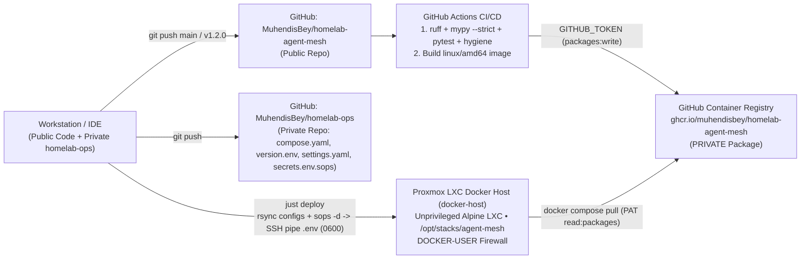

# Deployment & GitOps Architecture (`homelab-agent-mesh` v1.2.0)

> [!IMPORTANT]
> **Strict Secret Hygiene:** This public repository NEVER stores real LAN IP addresses, `.env` files, `config/settings.yaml`, SQLite databases, or SSH/age private keys. All network examples below use RFC 5737 documentation addresses (`192.0.2.x`) and placeholder variables.

---

## 1. Two-Repository GitOps Design

To keep the application source code open-source (`MIT`) while keeping homelab topology, device aliases, and API credentials strictly private, deployment follows a **Dual-Repository Separation Model**:

| Repository | Visibility | Purpose & Contents |
|---|---|---|
| **`MuhendisBey/homelab-agent-mesh`** *(this repo)* | Public | 12-Factor Python application code, unit tests (`pytest`), `.dockerignore`, and GitHub Actions CI/CD workflow ([`.github/workflows/ci.yml`](../.github/workflows/ci.yml)). Produces immutable `linux/amd64` container images pushed to **private GHCR**. |
| **`MuhendisBey/homelab-ops`** *(local clone: `./homelab-ops/`, gitignored)* | **Private** | Environment manifests (`stacks/agent-mesh/compose.yaml`), pinned image tag (`version.env`), real `settings.yaml`, operational `justfile`, LXC bootstrap script, and **SOPS + age** encrypted secrets (`secrets.env.sops`). |

### Why This Split?
1. **Architecture Portability (`arm64` Dev → `amd64` Prod):** Development runs on Apple Silicon (`arm64`), while the production Proxmox LXC Docker host runs on `x86_64` (`linux/amd64`). GitHub Actions builds native `linux/amd64` images reproducibly without slow QEMU emulation on the workstation or compiler toolchains inside the LXC.
2. **Zero-Secret Container Images:** `.dockerignore` blocks `.env`, `config/settings.yaml`, and `data/*.db` from entering the build context, and the CI pipeline runs a post-build container inspection verifying `/app/.env` and `/app/config/settings.yaml` do not exist inside the pushed image.
3. **Encrypted-at-Rest Operations:** Credentials inside `homelab-ops` are encrypted in Git using **Mozilla SOPS** with an **age** X25519 keypair whose private key (`~/.config/sops/age/keys.txt`) never leaves the operator's workstation.
4. **Agent-Less Host:** No Kubernetes, Nomad, or Watchtower agent needs to run on the LXC container; deployments are deterministic, auditable, push-based operations driven by `just`.

---

## 2. End-to-End CI/CD & Deployment Topology



---

## 3. Declarative Secret & Release Workflow (`homelab-ops`)

Inside the private `homelab-ops` repository (`<workspace_root>/homelab-ops/`):

```text
homelab-ops/
├── .gitignore                     # Blocks plaintext .env, *.decrypted, keys, data/
├── .sops.yaml                     # Maps *.env.sops files to the age1... public key
├── justfile                       # Unified operational CLI (deploy, rollback, logs, ps, sync-data)
├── scripts/
│   └── bootstrap-lxc900.sh        # One-time Alpine LXC user, dir & DOCKER-USER firewall setup
└── stacks/
    └── agent-mesh/
        ├── compose.yaml           # Pulls ghcr.io/muhendisbey/homelab-agent-mesh:${IMAGE_TAG}
        ├── version.env            # Pinned release tag (e.g., IMAGE_TAG=v1.2.0, APP_PORT=8028)
        ├── settings.yaml          # Host-specific YAML configuration (mounted :ro)
        └── secrets.env.sops       # SOPS/age encrypted .env payload
```

### Deployment Sequence (`just deploy`)

```mermaid
sequenceDiagram
    autonumber
    participant Op as Operator / Justfile
    participant SOPS as Local SOPS + age key
    participant LXC as LXC Docker Host (SSH deploy@<HOST>)
    participant GHCR as Private GHCR

    Op->>Op: Optionally bump IMAGE_TAG in stacks/agent-mesh/version.env
    Op->>LXC: rsync compose.yaml, settings.yaml, version.env -> /opt/stacks/agent-mesh/
    Op->>SOPS: sops -d stacks/agent-mesh/secrets.env.sops
    SOPS-->>LXC: Pipe decrypted env directly via SSH ("umask 077; cat > .env")
    Note over Op,LXC: Plaintext .env never touches git or workstation disk during deploy
    Op->>LXC: docker compose --env-file version.env pull
    LXC->>GHCR: Authenticate (read:packages) & pull linux/amd64 image
    Op->>LXC: docker compose --env-file version.env up -d --remove-orphans
    Op->>LXC: Poll http://127.0.0.1:${APP_PORT}/api/v1/health
```

### Instant Rollback (`just rollback <tag>`)
Because `stacks/agent-mesh/version.env` pins immutable image tags (`v1.2.0`, `sha-<7char>`), rolling back to any prior release requires only:

```bash
cd homelab-ops
just rollback v1.2.0   # or just rollback sha-a63493c
```

---

## 4. Target Host Hardening (LXC Docker Host)

To minimize blast radius on the unprivileged Alpine LXC running alongside other homelab workloads:

1. **Dedicated Non-Root Deploy User:** Create a dedicated `deploy` account in the `docker` group, authenticate strictly via SSH public keys (`PasswordAuthentication no`), and restrict stack ownership to `/opt/stacks/agent-mesh`.
2. **Egress & Ingress Firewall (`DOCKER-USER` Chain):** Docker bypasses standard `INPUT` rules via DNAT. Published container ports (e.g., `${APP_PORT}/tcp`) must be guarded inside `iptables` **`DOCKER-USER`**:
   - Allow established/related return traffic (`ctstate ESTABLISHED,RELATED`).
   - Allow ingress strictly from:
     - Home Assistant OS VM (`192.0.2.10/32` example)
     - Management workstation (`192.0.2.20/32` example)
     - Tailscale CGNAT subnet (`100.64.0.0/10`)
     - Localhost loopback / container bridge
   - Drop all other external traffic hitting the service port (`-j DROP`).
3. **Private GHCR Access Token:** The LXC performs `docker login ghcr.io` once with a fine-grained Personal Access Token scoped **only** to `read:packages`.
4. **Runtime Footprint & Socket Isolation:**
   - Container memory cap is set to `128M` (`mem_limit`).
   - `/var/run/docker.sock` is mounted read-only (`:ro`) unless container lifecycle mutations (`start`/`stop`/`restart`) are explicitly enabled for the Infrastructure sub-agent.

---

## 5. Persistent State & Initial Migration

`homelab-agent-mesh` stores four persistent SQLite structures (in WAL mode) under the bind-mounted `./data/` directory:
- `lessons_learned` (3-Tier `ReflectionStore`)
- `entity_memory` (CoALA semantic entity aliases & Beta-Bernoulli confidence scores)
- `entity_registry_snapshot` (cached Home Assistant Grounding Index)
- `scheduled_actions` (`ActionScheduler` pending/completed timers & Actor-Critic results)

### Migrating Local Workstation State → LXC
1. Stop local Docker Compose instance cleanly (flushing WAL journals): `cd homelab-agent-mesh && docker compose down`.
2. Sync SQLite files via `just sync-data` from `homelab-ops`.
3. Execute `just deploy` and verify `/api/v1/health`, `/api/v1/entities/resolve`, and `/api/v1/schedules`.

---

## 6. Agent Session Handover Guidelines

For future AI agent sessions operating in this workspace:
- **Where Private Ops Files Live:** Check sibling/root directory `../homelab-ops/` (gitignored inside `AgentCrew/`) paired with private GitHub repository `MuhendisBey/homelab-ops`.
- **Never Cross Boundaries:** Never copy `homelab-ops/stacks/agent-mesh/settings.yaml`, `.env`, `secrets.env.sops`, real LAN IPs, or SSH keys into `MuhendisBey/homelab-agent-mesh`.
- **Inspecting Target Runtime State:** Use the Docker context configured for the LXC (`just ps` / `just logs`) or query `GET /api/v1/health` rather than assuming container names on the host match local dev environments (`safety.protected_containers` in `homelab-ops` `settings.yaml` must reflect LXC host containers).
