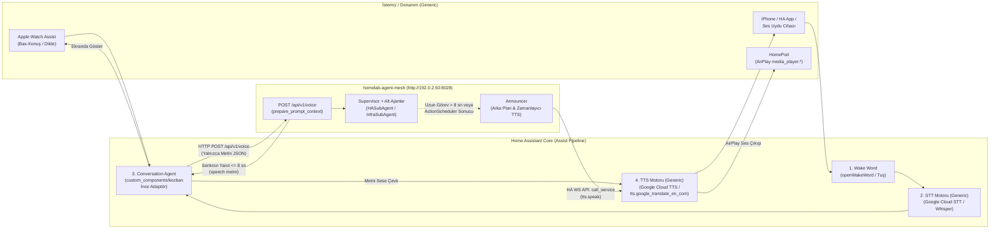
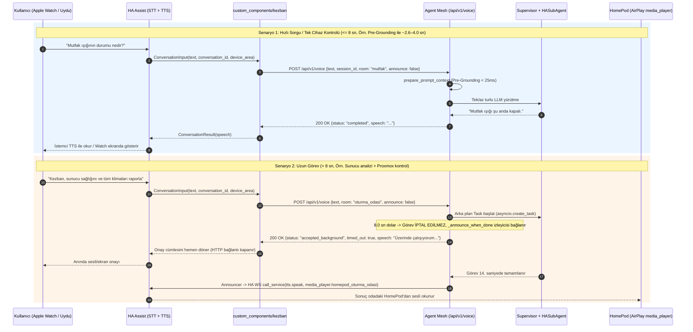

# Home Assistant & Assist Pipeline Entegrasyon Mimarisi (`homelab-agent-mesh` P4/P5)

> [!IMPORTANT]
> **Katı Gizlilik İlkesi:** Bu doküman public depoda yer alır. Gerçek yerel ağ (LAN) IP adresleri, API token'ları, `homelab-ops/` içerikleri veya kişisel cihaz kimlikleri **kesinlikle içermez**. Tüm ağ örnekleri RFC 5737 dokümantasyon adreslerini (`192.0.2.x`) ve şablon yer tutucularını kullanır.

---

## 1. Kısa Cevap: STT/TTS Generic mi, Ajan Bağımlılığı Nerede?

P5 aşamasında kurulacak Home Assistant sesli asistan entegrasyonu (`custom_components/kezban` + Assist Pipeline + Google Cloud STT/TTS + Apple Watch) **tek parça (monolitik) bir yapı değildir**; Home Assistant'ın standart ve modüler **Assist Boru Hattı (Assist Pipeline)** mimarisine dayanır:

1. **STT (Konuşmayı Metne Çevirme) ve TTS (Metni Sese Çevirme) `%100 generic`'tir ve `homelab-agent-mesh` uygulamasından tamamen bağımsızdır.**
   - STT (`Google Cloud STT`, `Whisper`, Apple Watch yerel dikte) ve TTS (`Google Cloud TTS`, `Piper`, `tts.google_translate_en_com`) Home Assistant içinde ayrı birer entegrasyon olarak çalışır.
   - `homelab-agent-mesh` konteyneri **kapalı olsa bile**, Home Assistant bu STT ve TTS servislerini otomasyonlarda (`tts.speak`), medya oynatıcılarda, başka LLM entegrasyonlarında (OpenAI/Gemini Conversation) veya HA'nın yerleşik yerel intent motorunda bağımsız olarak kullanmaya devam eder.
   - `homelab-agent-mesh` içine hiçbir zaman **ham ses verisi (audio stream)** girmez veya oradan ham ses üretilmez; tüm iletişim yalnızca **UTF-8 metin** (`text` -> `speech`) düzeyindedir.
2. **Ajanlarımıza (`homelab-agent-mesh`) bağımlılık boru hattının yalnızca tek bir halkasında — 3. Aşama olan `Conversation Agent` katmanında — oluşur:**
   - Bu bağlantıyı sağlayan **`custom_components/kezban`**, Home Assistant'ın `conversation.AbstractConversationAgent` arayüzünü uygulayan **ince bir adaptördür (Thin Adapter)**.
   - İçinde hiçbir LLM istemi (prompt), hafıza (`ReflectionStore`), varlık çözümleyici (`EntityResolver`) veya iş mantığı barındırmaz; görevi yalnızca kullanıcı metnini (`text`), oturum kimliğini (`conversation_id -> session_id`) ve oda bağlamını (`room`) HTTP üzerinden `POST /api/v1/voice` uç noktasına aktarıp dönen `speech` metnini Assist'e geri vermektir.

---

## 2. Home Assistant Assist Boru Hattının 4 Aşaması

Home Assistant Assist mimarisi, sesli komut işleme sürecini birbirinden değiştirilebilir 4 bağımsız aşamaya böler:

### Aşama Bazlı Sorumluluk ve Değiştirilebilirlik Matrisi

| Aşama | Görev | Nerede Çalışır? | `homelab-agent-mesh` Bağımlılığı | Değiştirilebilirlik |
|---|---|---|---|---|
| **1. Wake Word / Tetikleme** | Mikrofonu dinleme veya tuşla oturum başlatma | HA Uydu / Apple Watch / iPhone | **Yok** (Ek olarak `prepare_prompt_context`, metnin başındaki `Hey Kezban` / `Kezban` ekini yazılım tarafında da temizler) | `openWakeWord`, `microWakeWord`, Apple Siri Kestirmesi veya donanım tuşu seçilebilir. |
| **2. STT (Ses → Metin)** | Ham ses akışını Türkçe metne dönüştürme | Home Assistant veya İstemci (Apple Dictation) | **Yok** | `Google Cloud STT`, yerel `Whisper` eklentisi veya iOS/watchOS dikte arasında geçiş ajanda **sıfır kod değişikliği** gerektirir. |
| **3. Conversation Agent (Metin → Niyet & Eylem)** | Doğal dili anlama, güvenli kontrol, doğrulama, yanıt üretme | `custom_components/kezban` → `homelab-agent-mesh` | **TEK BAĞIMLILIK NOKTASI** | HA ayarlarından Assist boru hattının Conversation ajanı başka bir ajan (örn. yerleşik HA Assist) seçildiğinde `homelab-agent-mesh` anında devreden çıkar. |
| **4. TTS (Metin → Ses)** | Yanıt metnini sese çevirip hoparlöre çalma | Home Assistant (`tts.speak` / Assist pipeline) | **Doğrudan yok** (Asenkron push akışında `Announcer` yalnızca HA'nın mevcut `tts.speak` servisini tetikler) | `Google Cloud TTS`, `Piper` veya `tts.google_translate_en_com` arasında `settings.yaml` (`voice.tts_entity`) ile değiştirilebilir. |

> [!TIP]
> **Apple Watch Neden Özel Bir Avantaj Sağlar?**
> Apple Watch üzerinden HA Assist çalıştırıldığında watchOS çoğu durumda sesi zaten Apple sunucularında/cihazda dikte ederek doğrudan **metne** çevirir (bu akışta HA STT adımına bile gerek kalmaz) ve cevabı saat ekranında metin olarak gösterir. Buna karşın iPhone Assist veya fiziksel ses uyduları ses gönderdiğinde HA'nın generic STT + TTS motorları devreye girer. `homelab-agent-mesh` her iki durumda da aynı `POST /api/v1/voice` arayüzüyle çalışır.

---

## 3. Çift Yönlü Bağımlılık Haritası (`Home Assistant ↔ homelab-agent-mesh`)

İki sistem birbirine gevşek bağlı (loosely coupled) HTTP ve WebSocket sözleşmeleriyle bağlanır:

### Yön A: Home Assistant → `homelab-agent-mesh` (Gelen İstekler / Inbound)

P5 eklentisi olan `custom_components/kezban`, yalnızca aşağıdaki iki HTTP uç noktasını kullanır:

1. **Sağlık Kontrolü (`ConfigEntry` / UI Kurulum Doğrulaması):**
   - `GET http://192.0.2.50:8028/api/v1/health`
   - Bağlantı ve sürüm teyidi yapar (`status: "ok"`, `active_sub_agents`).
2. **Konuşma İşleme (Conversation Turn):**
   - `POST http://192.0.2.50:8028/api/v1/voice` (`VoiceCommandRequest` → `VoiceCommandResponse`)
   - İstek gövdesi alanları (`src/api/schemas.py`):
     - `text`: STT veya klavyeden gelen ham metin (`"Kezban, mutfak ışıklarını aç"`).
     - `session_id`: HA `ConversationInput.conversation_id` değeri (aynı sohbette zamir takibi ve takip soruları için `Supervisor` `SlidingWindowConversationManager` oturumunu korur).
     - `room`: İstemci cihazının HA Alan (Area) kayıtlarından türetilen oda adı (örn. `"mutfak"`, `"oturma_odasi"`). `prepare_prompt_context` bu bilgiyle belirsiz komutları (`"ışığı aç"`) oda varlığına odaklar ve gerektiğinde doğru HomePod'u seçer.
     - `speaker_entity` / `announce`: Assist kendi pipeline TTS'ini çalacaksa `announce: false` gönderilir (çift ses çakışmasını önlemek için); uzaktan/sessiz bir istemciden HomePod'a okutulması istenirse `announce: true` kullanılabilir.
     - `timeout_sec`: İsteğe bağlı senkron bekleme bütçesi (varsayılan `voice.sync_timeout_sec = 8.0` sn).

#### `custom_components/kezban` Neden "Aptal Adaptör" (Thin Adapter) Olmalıdır?
- Home Assistant kendi ayrı LXC/VM ortamında koşar; güncellemeleri (`HA Core`) bağımsızdır.
- Eklenti içinde prompt şablonu, Gemini API anahtarı, cihaz eşleme kuralı veya TTS metin temizliği tutulursa her kural iki yerde birden güncellenmek zorunda kalır.
- Tüm zeka (`prepare_prompt_context` Pre-Grounding, `Supervisor`, `HASubAgent`, `InfraSubAgent`, `ActionScheduler`, güvenlik kalkanları, `clean_for_tts`) `homelab-agent-mesh` konteyneri içinde kalır; `custom_components/kezban` yalnızca `AbstractConversationAgent` nesnesinden HTTP JSON köprüsü kurar (yaklaşık ~120 satır Python kodu).

### Yön B: `homelab-agent-mesh` → Home Assistant (Giden Çağrılar / Outbound)

`homelab-agent-mesh` uygulamasının Home Assistant'a bağımlı olduğu (HA API'lerini tükettiği) üç kanal vardır:

1. **Home Assistant WebSocket API (`ws://192.0.2.10:8123/api/websocket` — `HomeAssistantWSAdapter`):**
   - **Gerçek Zamanlı Topoloji Senkronizasyonu (`EntityResolver`):** Başlangıçta cihaz/alan/kat/varlık kayıtlarını çeker; ardından `entity_registry_updated`, `device_registry_updated`, `area_registry_updated` ve `floor_registry_updated` olaylarına abone olur. HA'da bir cihazın adı veya odası değiştiğinde ek sorguya gerek kalmadan milisaniyeler içinde güncellenir.
   - **Cihaz ve Servis Kontrolü (`call_service`):** `light.turn_on`, `switch.turn_off`, `climate.set_temperature`, `execute_sequential_loop` ve özel olay tetikleme (`fire_custom_ha_event`).
   - **Asenkron & Zamanlanmış Duyurular (`Announcer` → `tts.speak`):** `POST /api/v1/voice` 8 saniye içinde dönemediğinde (`accepted_background`) veya `ActionScheduler` ileri tarihli bir işi tamamladığında (`ScheduleResultEvent`), hedef odadaki HomePod `media_player.*` varlığına HA'nın kendi `tts.speak` servisiyle (hata durumunda `tts.google_translate_say` yedeğiyle) ses gönderir.
2. **Home Assistant REST API (`http://192.0.2.10:8123/api/states`):**
   - **Pre-Grounding Canlı Durum Enjeksiyonu:** `prepare_prompt_context` içinde yüksek güvenle eşleşen varlıkların anlık durum ve niteliklerini (`state`, `temperature`, `current_temperature`, `hvac_action`, `brightness`, `unit_of_measurement`) 1.0 sn zaman aşımı korumasıyla paralel okuyarak ek LLM turunu ortadan kaldırır.
   - **Actor-Critic Fiziksel Doğrulama (`assert_entity_state`):** Bir mutasyon sonrasında cihazın gerçekten hedef duruma geçtiğini doğrular (`StateAssertionSuccess` / `StateAssertionFailure`) ve CoALA `entity_memory` güven skorunu artırır.
3. **Harici `ha-mcp` SSE Sunucusu (Opsiyonel Yedek Keşif):**
   - Yerel `EntityResolver` güven skoru eşik değerinin altında kaldığında (`<0.85`) yalnızca okuma/keşif yedeği (`ha_mcp_ha_search`) olarak kullanılır.

---

## 4. Senkron vs. Asenkron Ses Akışı (8 Saniye Bütçe Modeli)

Home Assistant Assist arayüzleri (Apple Watch, iPhone, ses uydusu) uzun süre HTTP yanıtı beklerse zaman aşımına düşer. `POST /api/v1/voice` bunu **`sync_timeout_sec` (8.0 sn) + arka plan devri** modeliyle çözer:

### Güvenlik ve Onay Durumlarında (Two-Phase Commit / HITL) Sesli Davranış

- Yıkıcı bir eylem (`safety.destructive_tools_requiring_approval`, örn. kritik konteyner yeniden başlatma veya node reboot) istendiğinde ajan işlemi fiziksel olarak duraklatır.
- `/api/v1/voice` bu durumda `status: "approval_required"`, `pending_approvals: ["<approval_id>"]` ve sesli okunabilir bir uyarı (`speech`) döner; fiziksel eylem kullanıcı onay vermeden asla çalıştırılmaz.
- HVAC sıcaklık sınır ihlali (`min_hvac_temp` / `max_hvac_temp`) veya açık pencere donma koruması (`window_open_guard_temp`) devreye girdiğinde ise `HASubAgent` neden reddettiğini açıklayan kısa Türkçe yanıtı `speech` alanıyla döndürür.

---

## 5. Bağımlılık İzolasyonu ve Özelleştirme Özeti

| Soru | Yanıt | Teknik Dayanak |
|---|---|---|
| **STT/TTS altyapısını başka amaçlarla kullanabilir miyim?** | **Evet, %100.** | STT ve TTS `homelab-agent-mesh` içine gömülü değildir; Home Assistant entegrasyonu olarak tüm otomasyonlara ve standart Assist ajanlarına açıktır. |
| **`homelab-agent-mesh` çökerse veya bakım için kapatılırsa ne olur?** | HA Assist, yerel intents ve otomasyon TTS bildirimleri çalışmaya devam eder. | `custom_components/kezban` bağlantı hatası veya zaman aşımı yakalayıp kullanıcıya anlaşılır hata döner; HA Core'u bloklamaz. |
| **İleride `custom_components/kezban` başka bir REST API ile konuşturulabilir mi?** | **Evet.** | Adaptör yalnızca `POST /api/v1/voice` benzeri bir `{text, session_id, room}` → `{speech}` sözleşmesine bağlıdır. |
| **Google STT/TTS yerine yerel Whisper/Piper'a geçersem ajan kodunu değiştirmem gerekir mi?** | **Hayır (Sıfır kod değişikliği).** | Ses işleme HA Assist Pipeline ayarından seçilir. Yalnızca asenkron HomePod push duyurusu için `settings.yaml` içindeki `voice.tts_entity` güncellenir. |
| **Apple Watch üzerinde ekstra uygulama yazmam gerekir mi?** | **Hayır.** | WatchOS üzerindeki standart Home Assistant Assist aksiyonu, HA sunucusundaki `Kezban` boru hattına bağlandığında doğrudan çalışır. |
